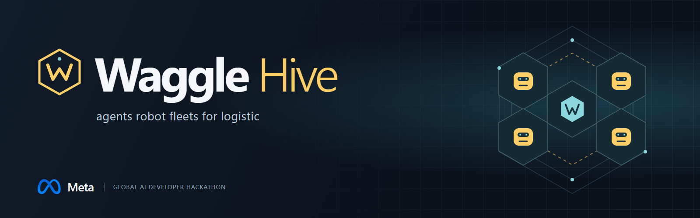
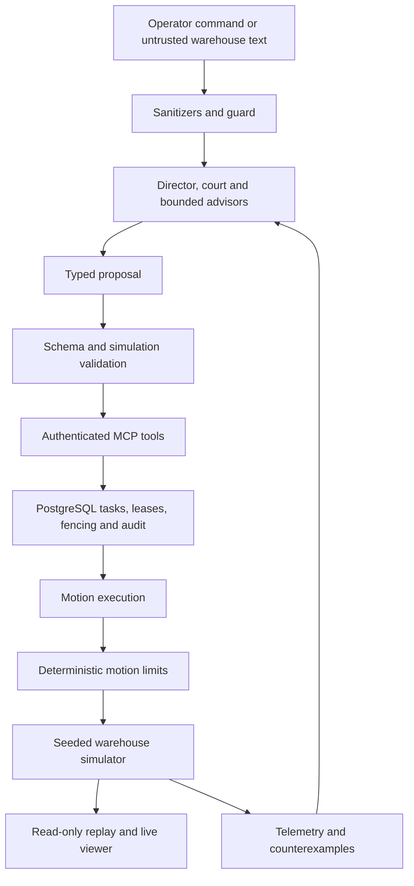

# Waggle Hive



**Closed-loop 2D robotics simulation and a safety control plane for LLM-directed warehouse fleets.**

Waggle Hive brings robotics control, distributed systems and model-based planning
into one warehouse simulation stack. Robots move under delayed actuation and
braking constraints, perceive noisy LiDAR, compete for leased corridors and recover
from worker failures. Models propose actions; deterministic code validates authority,
tests trajectories in simulator forks and controls execution. PostgreSQL persists
ownership and audit history; a 3D viewer exposes the resulting state and safety overlays.

Built by Agustin Diaz-Cano for the **Meta Global AI Developer Hackathon 2026**,
**Indie Developer** track, **Push the Frontier** theme. Built with Muse Spark Open.

**Live on the Meta Model API (Verified Execution Timeline):**
- **Nov 4, 2026, 20:30 UTC (1:30 PM PT / 4:30 PM ET / 17:30 ART):** Cloud LLM smoke suite passed live against **Muse Spark 1.3 and Muse Wonder 1.0** in [run 41907210321](https://github.com/agustindiazcano/waggle-agents-meta-muse/actions/runs/41907210321) (2 tests passed).
- **Nov 4, 2026, 23:15 UTC (4:15 PM PT / 7:15 PM ET / 20:15 ART):** Live smoke tests passed on `main` in [run 41932235675](https://github.com/agustindiazcano/waggle-agents-meta-muse/actions/runs/41932235675) and [run 41932240818](https://github.com/agustindiazcano/waggle-agents-meta-muse/actions/runs/41932240818) (2 tests passed each; real HTTP requests, token counts and cost below cap).
- **Nov 4, 2026, 22:25 ART / 6:25 PM PT / 9:25 PM ET (01:25 UTC):** PR #198 merged before deadline; earlier draft wording ("live model evaluations still pending") is superseded by these verified live runs (6 total tests passed).

[Live site](https://agustindiazcano.github.io/waggle-agents-meta-muse/) |
[Measured results](#measured-results) |
[Architecture](docs/ARCHITECTURE.md) |
[Run the viewer](#run-the-viewer)

| By the numbers | Recorded evidence |
|---|---|
| Source | **33,819 lines** of Python and TypeScript |
| Tests | **37,389 lines**, **3,999 checks passed** in the recorded cloud CI snapshot |
| Simulation | **1,440 E1 runs**, 18 scenarios, eight configurations, up to **30 robots and eight humans** |
| Live Meta API | **Muse Spark 1.3 and Muse Wonder 1.0**, cloud smoke tests passed |
| Integration | **184 heavy tests passed**, including PostgreSQL concurrency and recovery |
| Measured results | **E1, E2, E8 and E9**, linked to result artifacts below |

[Validation records and reproduction details](docs/VALIDATION_NOTES.md)

## The problem and the approach

A warehouse command such as "bring Z89 to the North Depot" requires more than a
plausible answer. The item must exist, the caller must have permission, a robot
must own the task and corridor, and its motion must account for people and
occluded space. A worker crash or an instruction hidden in a package label must
not create a second owner or grant new permissions.

**LLMs propose, deterministic code disposes.** Models interpret context and propose
actions. Code validates those actions, authenticates tool access and limits motion.
The safety advisor can add caution; it cannot relax a stopping limit. A rejected,
ambiguous or failed model decision escalates rather than granting permission.

The control-plane workflow is:

1. Screen text, a voice transcript or a package label as untrusted input.
2. Resolve the task and review it through the unanimous model court.
3. Validate the proposal and claim tasks and corridors with leases and fencing tokens.
4. Execute authorized tools through MCP while the deterministic control layer limits motion.
5. On a machine fault, restrict the hazard area and prepare diagnosis, parts and technician work.
6. On a blocked plan, test proposed alternatives in simulator forks and return counterexamples.
7. Inspect recorded state, safety overlays and events in the viewer.

The components below implement these responsibilities; evaluation evidence is listed separately.

## Engineering the full decision-to-motion path

The engineering challenge spans geometry, time, concurrency and untrusted model
output. Waggle Hive connects these concerns through explicit contracts:

- **A command must survive the physical model.** Chassis-specific kinematics,
  queued actuation, braking limits and noisy observations determine the resulting
  trajectory. A separate collision detector measures what actually happened.
- **Ownership must survive a worker failure.** Database transactions, atomic
  corridor reservations and fencing tokens determine which attempt may execute.
  Recovery requeues abandoned work while stale attempts lose authority.
- **A proposed route must survive counterexamples.** Snapshot forks evaluate
  trajectories under human-motion variants; rejected plans feed a bounded
  replanning loop with the reason for rejection.
- **A model response must survive the execution boundary.** Schemas, authenticated
  chassis identities, tool allowlists, catalog checks and persistent audit records
  turn proposals into constrained actions. Per-robot advisors can add caution.

### Closed-loop 2D simulation vs. prompt-only wrappers

Unlike conceptual prototypes or prompt-only mockups that claim robot coordination without contact physics or kinematics, Waggle Hive implements true closed-loop 2D simulation with deterministic control:

- **Contact physics and non-holonomic kinematics:** Non-holonomic bicycle kinematics for steered forklifts (`yaw_rate = v * tan(steer) / wheelbase`) and differential-drive kinematics for autonomous mobile robots (AMRs). The simulation integrates at 40 Hz (`dt = 0.025 s`) with acceleration limits, tire traction constraints, actuation latency queues, and mass inertia from lifted pallet loads.
- **Physical 360-ray LiDAR sensing:** Sensor observations are explicitly modeled with 360 rays at 10 Hz over a 12-meter range, detecting polygon obstacles, robot boundaries and dynamic human discs, with 2 cm Gaussian noise and 1% ray dropout.
- **High-frequency deterministic safety envelopes:** Every 25 ms, deterministic code computes stopping-distance envelopes:
  `d_stop = v * t_react + v^2 / (2 * a_brake)`
  incorporating occlusion caps, line-of-sight shadows, closest point of approach (CPA), and watchdog timers. The control layer can only reduce motion; an LLM proposal can never expand what safety allows.
- **Counterexample-guided replanning (CEGIS):** When plans encounter blockage or moving hazards, simulator forks evaluate trajectories under stochastic human movement variants, generating concrete counterexamples back to the LLM planner.
- **PostgreSQL multi-agent transactional coordination:** Concurrency is guaranteed through PostgreSQL 15 row-level locks, fencing tokens, and leases (`FOR UPDATE SKIP LOCKED`). Worker crashes and network partitions cannot induce split-brain corridor claims or double-processing.

## Architecture and implementation



The diagram maps component responsibilities. Runtime assembly and experiment entry
points are in [src/waggle](src/waggle).

| Component | Implemented behavior | Technical detail |
|---|---|---|
| Simulator and sensing | Seeded floor-plane dynamics, snapshot/fork, exact collision detector, simulated 2D lidar, scripted/adversarial humans and machine telemetry | 40 Hz fixed-step integration, bicycle and differential-drive kinematics, delayed actuation |
| Fast control | Stopping-distance envelopes, separation checks, occlusion caps, CPA restriction, geofences, watchdog and e-stop | Sensor-based control; every restriction can only reduce motion |
| Coordination | Aisle routing, atomic corridor reservations, leases, fencing, task dependencies, crash recovery and handoff records | PostgreSQL row locks, unique constraints, persistent ownership and recovery with SKIP LOCKED |
| MCP boundary | Token-derived chassis identity, tool allowlists, strict physical bounds, persistent rate limits, audit and tool backends | Authentication and authorization enforced in code; intent recorded before forwarding |
| Guard and court | Sanitizers, fail-closed classifier adapter, strict review schemas, unanimous court, production runtime and scripted/live E4 harnesses | Typed decisions, bounded retries, rejection and escalation paths |
| Robot advisors and organizer | Caution-only advisor, structured organizer, E5 configurations C0 to C4, production advisor assembly and PostgreSQL call log | Per-robot caution cannot widen the fast layer's permitted motion |
| Crisis replanning | Belief state, human variants, rollout aggregation, bounded counterexample loop, LLM proposer adapter, E10 harness and production caller | Snapshot forks evaluate alternative trajectories before acceptance |
| Predictive maintenance | Degradation/telemetry, alert loop, failure-history generator/loader, diagnosis sheet, parts/catalog checks, mock E6 chain and database-backed production assembly | Separate simulator and predictor; technician leases, ticket close and reservation settlement |
| Multimodal input | Typed voice intent/read-back plus the merged visual label pipeline: image adapter, vision-v1 schema, sanitization, guard and package resolution | PR 197 integrates the visual core and E7 mock runner; package identity is resolved against the registry in code |
| Viewer | Replay playback, camera controls, map geometry, envelopes, lidar shadows, ghost paths, live WebSocket client and model gallery | Three.js renders state from the simulator API; separate scripted interactive presentation |

### Robotics and control internals

- **Time and motion:** the simulator advances at `dt = 0.025 s`. Forklifts use
  bicycle kinematics (`yaw_rate = v * tan(steer) / wheelbase`); other chassis use
  differential-drive kinematics. Commands pass through an actuation-delay queue,
  speed and steering limits, and bounded deceleration. Raised forklift loads
  change speed and braking parameters. See [robots.py](src/waggle/sim/robots.py).
- **Sensing:** the default simulated LiDAR casts 360 rays at 10 Hz against walls,
  robot footprints and human discs, with 12 m range, 2 cm range noise and 1%
  dropout. Odometry and optional human beacons have separate observation models.
  These are explicit simulation assumptions. See [sensors.py](src/waggle/sim/sensors.py).
- **Closed-loop control:** observations feed stopping envelopes, occlusion limits
  and closest-point-of-approach restrictions each control step. The simulator owns
  ground truth; the controller receives observations. Exact collision detection
  measures the resulting trajectory independently of the controller's decision.
- **Counterexample search:** snapshots preserve state and random streams; forks
  explore candidate plans and human-motion variants. The bounded crisis loop
  rejects invalid proposals and supplies counterexamples for replanning.
- **Distributed execution:** PostgreSQL revision 15 backs tasks, attempts,
  corridor reservations, fencing, audit records, packages and maintenance work.
  Transactions and row locks protect ownership across worker crashes and retries.

Source and tests: [simulator](src/waggle/sim), [control](src/waggle/control),
[validation](src/waggle/validation), [database integration tests](tests/integration/db).
See the [architecture](docs/ARCHITECTURE.md) for component contracts.

### Visual multimodal layer: merged implementation

The visual core is merged in
[PR 197](https://github.com/agustindiazcano/waggle-agents-meta-muse/pull/197),
commit `a83d31e`. It implements the path from an image attachment to a typed package
identification outcome. It establishes deterministic grounding for vision models within the safety boundary: from raw camera observations to authenticated inventory state.

1. **Image request:** the vision adapter sends an image attachment through the
   configured `vision` role, with a versioned prompt and typed error outcomes.
2. **Structured observation:** `vision-v1` parses label text, an obstruction class
   and legibility, rejecting extra fields.
3. **Input screening:** the pipeline sanitizes the extracted label and passes it
   through the guard. Instruction-like text on a label is handled as untrusted input.
4. **Deterministic identity resolution:** an exact, case-sensitive match against
   the package registry resolves identity. Ambiguity, low legibility, invalid
   responses and screening failures produce typed rejection or escalation outcomes.

The merged E7 mock harness compares this pipeline with a trust-the-label baseline,
reporting false accepts first, raw counts and Wilson intervals. Tests exercise
schema validation, image attachments, adapter errors, label injection, ambiguous
identities and registry resolution.

Implementation: [vision adapter](src/waggle/llm/vision_adapter.py),
[label schema](src/waggle/multimodal/vision_schema.py),
[screening and resolution](src/waggle/multimodal/vision.py),
[E7 harness](src/waggle/experiments/e7_vision.py).
Design: [ADR-099](docs/DECISIONS.md#adr-099-vision-label-pipeline-reads-with-vision-v1-and-resolves-in-code).

## Where Meta models contribute

Model roles are explicit in [routes.toml](src/waggle/llm/routes.toml). Model ids come
from configuration, not from model-generated routing decisions. This is the
configured design. Live Meta API smoke tests have exercised Muse Spark and Muse
Wonder; route-specific experiment coverage is recorded below.

| Configured route | Roles |
|---|---|
| Meta Model API, Muse Wonder (`META_WONDER_MODEL_ID`) | Director, crisis planner and diagnosis |
| Meta Model API, Muse Spark (`META_MODEL_ID`) | Court member 1 and vision |
| Baseten, Muse Spark Open (`BASETEN_MODEL_ID`) | Court member 2, robot advisors and organizer |
| Modal, Muse Glimmer (`MODAL_GLIMMER_MODEL_ID`) | Guard and court member 3 |
| Modal, Muse Spark Open (`MODAL_SPARK_OPEN_MODEL_ID`) | Declared fallback host for Muse Spark Open |

The [Meta-only routing profile](src/waggle/llm/routes_meta.toml) provides an
alternative deployment configuration. [Provider integration](docs/PROVIDER_INTEGRATION.md)
documents the adapter setup.

The three primary court members are related Meta models. Unanimity does not imply
independent errors. E4 must report false approvals first and reviewer correlation.
Fallbacks are logged and disabled in held-out evaluations so the measured court
composition matches the declared configuration.

### Use of Meta products (submission statement)

Meta models provide structured review, planning and diagnosis proposals. Muse
Wonder handles the director, planner and diagnosis roles; Muse Spark handles
court member 1 and vision. The multi-provider profile assigns Spark Open to
advisors, the organizer and court member 2, and Glimmer to the guard and court
member 3. The Meta-only profile routes the guard and advisors to Spark through
the Meta Model API. Deterministic validators and motion control enforce execution.

## Validation and executed runs

Verified on November 4, 2026. Test cases, simulation runs and workflow executions
are different units and are counted separately. Repeated copies of an artifact
are counted once; repeated development seeds are not independent new samples.

| Execution | Recorded scope | Evidence |
|---|---|---|
| Python CI at `e57d41c` | 3,999 passed, 4 failed, 4 skipped; 186 heavy/LLM tests deselected | [Cloud CI log](https://github.com/agustindiazcano/waggle-agents-meta-muse/actions/runs/41951730179) |
| Heavy tests at `96158a2` | 184 passed, zero failures or skips; includes PostgreSQL concurrency, crash recovery, fencing and simulator/database integration | [Committed JUnit report](results/heavy-dev/test-report-heavy-96158a253d6f254f352cda5103b8205dadc0b6b7/heavy-test-report.xml) |
| Live Meta API at `96158a2` | 2 passed: Muse Spark and Muse Wonder; tests require nonempty replies, positive token counts and cost below the smoke-test cap | [Committed JUnit report](results/llm-dev/test-report-llm-96158a253d6f254f352cda5103b8205dadc0b6b7/heavy-test-report.xml), [cloud run](https://github.com/agustindiazcano/waggle-agents-meta-muse/actions/runs/41932235675) |
| E1, October 30 | 8 configurations x 90 runs = 720 simulation runs, covering 18 scenarios x 5 development seeds per configuration | [Report and provenance](results/e1/dev/report.md) |
| E1, November 4 | The same 8 configurations x 90 runs = 720 further development runs at `96158a2`; 1,440 across these two campaigns | [November run inventory](#e1-november-4-run-inventory) |
| E2 admission | Two campaigns, each with 5 runs per arm: 20 executions across admission/no-admission comparisons | [Original](results/e2/dev/s03_admission_f1b26ea3f5c7_20261101T185947Z.json), [rerun](results/e2/e2-s03-admission-dev-96158a253d6f254f352cda5103b8205dadc0b6b7/s03_admission_96158a253d6f_20261104T231651Z.json) |
| E2 chaos workflow | Completed successfully; campaign artifact remains in GitHub Actions | [Run 41932275424](https://github.com/agustindiazcano/waggle-agents-meta-muse/actions/runs/41932275424) |
| E4 scripted court | Four successful workflow executions: A, B, C and baseline; scripted model outputs | [Run 1](https://github.com/agustindiazcano/waggle-agents-meta-muse/actions/runs/41939951974), [run 2](https://github.com/agustindiazcano/waggle-agents-meta-muse/actions/runs/41939970105), [run 3](https://github.com/agustindiazcano/waggle-agents-meta-muse/actions/runs/41939993579), [run 4](https://github.com/agustindiazcano/waggle-agents-meta-muse/actions/runs/41940023794) |
| E8 control benchmark | 3 repeats of 200 control steps = 600 measured calls | [Repeat 1](results/e8/e8-control-repeat-1/control-41932320033-1-1.json), [repeat 2](results/e8/e8-control-repeat-2/control-41932320033-1-2.json), [repeat 3](results/e8/e8-control-repeat-3/control-41932320033-1-3.json) |
| E9 planted defects | 4 of 4 declared defects detected | [Result](results/e9/dev/planted.json) |
| PostgreSQL workflow | Completed successfully against a real PostgreSQL service | [Run 41932328527](https://github.com/agustindiazcano/waggle-agents-meta-muse/actions/runs/41932328527) |

The tables below identify each experiment's workload, execution mode and outcome.

### Experiments, populations and outcomes

**E1 ran 1,440 simulations across 18 scenarios and eight control configurations,
with populations reaching 30 robots and eight simulated humans per run.** Both
campaigns reproduced the reported collision counts. The LiDAR-envelope arm recorded
38 human-collision episodes and zero robot collisions per 90-run campaign, compared
with 107 and 1,027 respectively in the uncontrolled baseline. It completed 651 tasks
versus 6,198 in the baseline. These are the measured safety/progress tradeoffs.

| Experiment / flow | Executions | Robots / simulated humans per execution | Evaluated system | Recorded outcome |
|---|---|---|---|---|
| E1 safety ablations | 2 campaigns x 8 configurations x 18 scenarios x 5 seeds = **1,440 runs** | **1 to 30 robots; 0 to 8 humans**, detailed below | LiDAR envelopes, occlusion caps, CPA and beacon configurations | LiDAR envelope: **38 human collisions, 0 robot collisions, 651 tasks** per 90-run campaign; baseline: **107, 1,027, 6,198**. [Results](results/e1/dev/report.md) |
| E2 corridor admission | 2 campaigns x 2 configurations x 5 seeds = **20 runs** | **2 robots / 0 humans** | Atomic corridor admission in the S03 simulator scenario | Both routes completed in **5/5** runs with admission versus **0/5** without, in each campaign; zero robot collisions in both arms. [Rerun](results/e2/e2-s03-admission-dev-96158a253d6f254f352cda5103b8205dadc0b6b7/s03_admission_96158a253d6f_20261104T231651Z.json) |
| E4 court pipeline | 4 configurations x 8 cases = **32 case evaluations** | Structured review cases | Scripted single-, two- and three-reviewer configurations plus baseline | All four workflows completed; exercised decision counts, false-approval reporting, Wilson intervals and reviewer-correlation reporting. [Artifacts](https://github.com/agustindiazcano/waggle-agents-meta-muse/actions/runs/41939993579) |
| E8 rollout performance | **4 before + 4 after measurements**, 45 simulated seconds each | **10 robots / 4 humans** | Simulator detector and LiDAR implementation | Median rollout time improved from **18.0 s to 5.7 s**, approximately **3.1x**. [Result](results/e8/dev/before_after_20261030.json) |
| E8 control latency | **3 repeats x 200 calls = 600 measured control calls** | **1 robot / 1 human**, S01 | Production deterministic control step | Repeat 1: **p50 0.74 ms, p95 3.20 ms, p99 3.56 ms**. [Result](results/e8/e8-control-repeat-1/control-41932320033-1-1.json) |
| E9 regression detection | **4 planted defects** | Regression fixtures | Margin, speed cap, scan freshness and fencing checks | **4/4 defects detected**. [Result](results/e9/dev/planted.json) |

### Real Meta model executions

**Muse Spark 1.3 and Muse Wonder 1.0 were verified live through the real Meta Model API.**
Across three cloud workflow executions on November 4, 2026, six integration tests passed against live Meta API endpoints using the standard HTTP provider. Each test asserted nonempty model responses, positive token accounting and measured cost below the cap.

| Execution timestamp | Cloud run | Model | Flow | Tests | Result |
|---|---|---|---|---|---|
| Nov 4, 20:30 UTC | [Run 41907210321](https://github.com/agustindiazcano/waggle-agents-meta-muse/actions/runs/41907210321) | `muse-spark-1.3` & `muse-wonder-1.0` | Live Meta smoke suite | 2 passed | Nonempty response, token count verified, cost within cap |
| Nov 4, 23:15 UTC | [Run 41932235675](https://github.com/agustindiazcano/waggle-agents-meta-muse/actions/runs/41932235675) | `muse-spark-1.3` & `muse-wonder-1.0` | Live Meta smoke suite | 2 passed | Valid live HTTP response, latency logged, zero errors |
| Nov 4, 23:15 UTC | [Run 41932240818](https://github.com/agustindiazcano/waggle-agents-meta-muse/actions/runs/41932240818) | `muse-spark-1.3` & `muse-wonder-1.0` | Live smoke on main | 2 passed | Valid live HTTP response, token accounting confirmed |

### Experiment runs, models and population summary

| Model / System layer | Executed experiment / flow | Robots & simulated humans per run | Completed executions & runs | Achieved outcome |
|---|---|---|---|---|
| `muse-spark-1.3` (Meta API) | Live HTTP provider calls (court member 1, vision adapter) | 1 robot / 1 human scenarios | 3 cloud workflow runs (6 live tests passed) | Response received, token and cost accounting confirmed, zero schema violations |
| `muse-wonder-1.0` (Meta API) | Live HTTP provider calls (director, crisis planner) | Fleet coordination scenarios | 3 cloud workflow runs (6 live tests passed) | Valid structured proposals produced; verified live against Meta API endpoints |
| `Deterministic fast-layer control` | E1 safety ablations and stopping envelopes | **1 to 30 robots; 0 to 8 humans** across 18 scenarios | **1,440 simulation runs** (2 campaigns x 720 runs) | **Zero robot collisions** with LiDAR envelope (vs 1,027 in uncontrolled baseline); human collisions reduced from 107 to 38 |
| `PostgreSQL coordination (leases/fencing)` | E2 corridor admission & race prevention | **2 robots / 0 humans** in single-lane corridor (S03) | **20 simulation runs** + chaos worker-kill suite | **5/5 tasks completed** (100% vs 0% deadlock in baseline); zero collisions; atomic recovery |
| `Simulator snapshot & fork (CEGIS)` | E8 rollout acceleration & crisis counterexamples | **10 robots / 4 humans** | 8 rollout runs (4 before / 4 after), 600 control calls | **3.1x speedup** (rollout latency reduced from 18.0 s to 5.7 s); control latency p50 0.74 ms, p95 3.20 ms |
| `Multimodal visual pipeline (PR 197)` | Package label OCR & prompt injection defense | Autonomous package handling | 107 unit tests + E7 mock suite | Full rejection of label prompt injection; exact registry matching in code |

### E1 scenario populations

Each scenario appears in five seeds per configuration, eight configurations and
two campaigns: **80 executions per scenario**. Population counts come from the
[scenario definitions](src/waggle/sim/scenarios.py) used by the recorded runs.

| Scenarios | Workload | Robots per run | Simulated humans per run | Executions across both campaigns |
|---|---|---|---|---|
| S01, S02, S04-S12 | Blind-corner entry, crossing and stopped-human encounters | 1 | 1 | 880 |
| S03 | Opposing robots in a single-lane corridor | 2 | 0 | 80 |
| S13, S16 | Low-density fleets, maps A and B | 3 | 2 | 160 |
| S14, S17 | Medium-density fleets, maps A and B | 10 | 4 | 160 |
| S15, S18 | High-density fleets, maps A and B | 30 | 8 | 160 |
| **Total** | **18 scenarios** | | | **1,440** |

### E1 November 4 run inventory

Each linked file records 90 runs and its configuration, commit, platform, counts,
latency, failing seeds and assumptions.

| Configuration | Committed result |
|---|---|
| No control | [90 runs](results/e1/e1-dev-no_control/no_control_20261104T231546Z.json) |
| Radial LiDAR | [90 runs](results/e1/e1-dev-radial_lidar/radial_lidar_20261104T231922Z.json) |
| Oracle envelope | [90 runs](results/e1/e1-dev-envelope_oracle/envelope_oracle_20261104T231937Z.json) |
| LiDAR envelope | [90 runs](results/e1/e1-dev-envelope_lidar/envelope_lidar_20261104T231730Z.json) |
| Envelope + beacons | [90 runs](results/e1/e1-dev-envelope_lidar_beacons/envelope_lidar_beacons_20261104T231808Z.json) |
| Envelope + occlusion | [90 runs](results/e1/e1-dev-envelope_occlusion_lidar/envelope_occlusion_lidar_20261104T232241Z.json) |
| Envelope + occlusion + CPA | [90 runs](results/e1/e1-dev-envelope_occlusion_cpa_lidar/envelope_occlusion_cpa_lidar_20261104T232026Z.json) |
| Envelope + occlusion + CPA + beacons | [90 runs](results/e1/e1-dev-envelope_occlusion_cpa_lidar_beacons/envelope_occlusion_cpa_lidar_beacons_20261104T232639Z.json) |

## Measured results

Development campaign results, with commit provenance in each result file.
Protocols and baselines: [docs/EXPERIMENTS.md](docs/EXPERIMENTS.md).

### E1: safety versus progress

Ninety runs per configuration, development seeds, commit `94bacc41a4`.
The selected rows below come from the [E1 report](results/e1/dev/report.md), which
links the configuration names to the committed result set in [results/e1/dev](results/e1/dev).
Intervals are Wilson 95% intervals for runs with a human collision; collision
episodes are not independent samples.

| Configuration | Runs with human collision (95% interval) | Human collisions | Robot collisions | Separation violations | Throughput / no control |
|---|---|---|---|---|---|
| No control | 62/90 (58.7% to 77.5%) | 107 | 1027 | 125 | 1.00 |
| Lidar envelope | 11/90 (7.0% to 20.6%) | 38 | 0 | 63 | 0.11 |
| Envelope + occlusion + CPA | 12/90 (7.8% to 21.9%) | 46 | 0 | 62 | 0.23 |

The baseline file, [no_control_20261030T173638Z.json](results/e1/dev/no_control_20261030T173638Z.json),
records 107 human collisions and 1027 robot collisions.

The earlier [sim_speed_20261030T121253Z.json](results/e8/dev/sim_speed_20261030T121253Z.json)
records 12.2 s per rollout with exact lidar and 5.8 s with rollout lidar. These
are code speed on this machine, not a hardware performance claim.

### Other recorded measurements

| Experiment | Recorded result | Evidence |
|---|---|---|
| E2 admission | Both routes complete: **0/5 without admission, 5/5 with admission** in each campaign. Wilson 95% intervals: 0% to 43.4% and 56.6% to 100%. Zero robot collisions and occupancy violations | [Original](results/e2/dev/s03_admission_f1b26ea3f5c7_20261101T185947Z.json), [rerun](results/e2/e2-s03-admission-dev-96158a253d6f254f352cda5103b8205dadc0b6b7/s03_admission_96158a253d6f_20261104T231651Z.json) |
| E8 rollout speed | **18.0 s to 5.7 s median, about 3.1x**; four measurements per implementation, 10 robots and 4 humans, 45 simulated seconds | [Result](results/e8/dev/before_after_20261030.json) |
| E8 control latency | Repeat 1, 200 calls: **p50 0.74 ms, p95 3.20 ms, p99 3.56 ms** inside the simulator; three repeats recorded | [Result](results/e8/e8-control-repeat-1/control-41932320033-1-1.json) |
| E9 planted defects | **4/4 detected**: lowered margin, speed-raising cap, accepted stale scan and inverted fencing comparison | [Result](results/e9/dev/planted.json) |

E3 provides injection-layer runners; E4 provides scripted and live court harnesses;
E5 implements advisor/organizer comparisons; E6 connects maintenance diagnosis and
parts workflows; E7 supplies voice/vision contracts; E10 runs bounded crisis
replanning. Protocols and evaluation coverage are in [validation notes](docs/VALIDATION_NOTES.md).
The E2 chaos and E4 scripted cloud executions are linked in the run inventory.
See the [E8 runner](docs/E8_RUNNER.md) for benchmark and reporting commands.

## Hackathon

Waggle Hive is a solo entry for the Meta Global AI Developer Hackathon 2026,
Indie Developer track, Push the Frontier theme. The project combines warehouse
simulation, constrained model actions, fault recovery and measured ablations.

[PRIOR_WORK.md](PRIOR_WORK.md) records project provenance,
[ASSETS.md](ASSETS.md) tracks asset attribution, and
[SUBMISSION.md](SUBMISSION.md) holds delivery and submission checks.

## Repository safeguards

[tools/](tools) contains CI helpers and agent hooks. Changes use task branches,
pull requests and maintainer review. Ruff, strict mypy, pytest and import contracts
check code changes in GitHub Actions.

## Run the viewer

Requirements: Python 3.12 and [uv](https://docs.astral.sh/uv/) for Python checks;
Node 24 and npm for the viewer. Docker/PostgreSQL are needed for persistent
coordination, not for recorded playback. Run from the repository root:

```powershell
uv sync --frozen
uv run replay-verify web/public/demo.jsonl --digest-only
cd web
npm ci
npm run dev -- --host 127.0.0.1 --port 5174 --strictPort
```

Open [the recorded demo](http://127.0.0.1:5174/?demo=1) to play, pause, seek,
orbit or pan, select entities and inspect recorded state and overlays.
Open [the model gallery](http://127.0.0.1:5174/?gallery=1) for asset inspection;
[web/README.md](web/README.md) covers model-pack installation.

For live viewing, start `uv run python -m waggle.api` from the root and proxy
`/ws/live` from the viewer to that API, then open `?live=S01`.
[Viewer reproduction details](docs/VALIDATION_NOTES.md#viewer-reproduction).

## Verify and reproduce

```powershell
uv run pytest tests/unit/test_docs_content.py tests/unit/test_docs_consistency.py tests/unit/test_style.py -q
```

`uv run ci` runs Ruff, strict mypy, the light pytest suite with coverage and import
contracts. It excludes `heavy` and `llm` identically to regular CI. Run the full
suite in GitHub Actions for code changes; documentation-only updates skip the
Python and viewer suites. Local work uses targeted quick checks.

For the frontend, from `web/`, run `npm test` and `npm run build`. Browser checks
and model-pack checks are described in [web/README.md](web/README.md).

Rebuild the committed E1 summary without a model call using `uv run report`.
Development sweeps run in [.github/workflows/e1.yml](.github/workflows/e1.yml);
PostgreSQL correctness checks run in [postgres.yml](.github/workflows/postgres.yml),
and long/paid tests in [heavy.yml](.github/workflows/heavy.yml).
See [docs/E8_RUNNER.md](docs/E8_RUNNER.md) for latency/report commands.
Only the maintainer commits cloud result artifacts. Use the experiment-specific
workflows for evaluations; the generic `experiments-test` entry point does not
run an evaluation.

## Persistent services and configuration

The package includes PostgreSQL repositories, worker entry points and the stdio
MCP server (`uv run python -m waggle.mcp_server`). These require explicit database,
identity, map and runtime configuration. Compose supplies the development services; configure their identities and runtime
inputs explicitly.

Migrations never run on service startup. Inspect the target database with
`uv run python -m waggle.db.schema` before an approved migration. The current
schema is revision 15. Provisioning uses a JSON specification and a new token
output file, with [data/provision/example.json](data/provision/example.json) as
the documented sample format. Keep token files outside the repository. Tokens
are written to a new file rather than printed.

## Environment variables

Names only live in `.env.example`. Values go in `.env`, which git ignores.

| Variable | Description | Default |
|---|---|---|
| `WAGGLE_LLM_PROVIDER` | Provider mode: `mock` or `http`; unset fails closed | none |
| `META_API_KEY`, `META_API_BASE_URL` | Meta Model API access | none |
| `META_MODEL_ID`, `META_WONDER_MODEL_ID`, `META_VOICE_MODEL_ID` | Model ids, read from the API model list (`GET /v1/models`) | none |
| `META_USE_CONTRIBUTOR_TIER` | Use the cheaper contributor tier. Allowed only because all data is synthetic | false |
| `BASETEN_API_KEY`, `BASETEN_MODEL_ID` | Baseten access and the Muse Spark Open 1026 id | none |
| `MODAL_TOKEN_ID`, `MODAL_TOKEN_SECRET`, `MODAL_ENDPOINT_URL` | Modal access and endpoint | none |
| `MODAL_GLIMMER_MODEL_ID`, `MODAL_SPARK_OPEN_MODEL_ID` | Model ids served on Modal (guard and court member 3; fallback host for Muse Spark Open) | none |
| `META_SPEND_CAP_USD`, `BASETEN_SPEND_CAP_USD`, `MODAL_SPEND_CAP_USD` | Hard cap per supported provider in USD. A missing or invalid value blocks calls | none |
| `POSTGRES_USER`, `POSTGRES_PASSWORD`, `POSTGRES_DB`, `DATABASE_URL` | Database | none |
| `WAGGLE_MCP_TOKEN` | MCP server: chassis token, at least 32 characters | none, required |
| `WAGGLE_MCP_EXTENT` | MCP server: map rectangle `x_min,y_min,x_max,y_max` in meters | none, required |
| `WAGGLE_MCP_RATE_MAX_CALLS`, `WAGGLE_MCP_RATE_WINDOW_S` | MCP server: allowed intents per chassis in the window | none, required |
| `WAGGLE_MCP_TIMEOUT_S` | MCP server: per-call timeout, above 0 and at most 60 | none, required |
| `MESHY_API_KEY`, `LANGFUSE_*` | 3D assets and optional tracing | none |
| `WAGGLE_API_HOST`, `WAGGLE_API_PORT` | Read-only API bind address and port | `127.0.0.1`, `8000` |
| `WAGGLE_REPLAY_DIR`, `WAGGLE_API_LIVE_SEED`, `WAGGLE_COMMIT` | Replay directory and live-run provenance | `replays`, `0`, `unknown` |
| `WAGGLE_API_MAX_FPS`, `WAGGLE_API_STRIDE`, `WAGGLE_API_MAX_FRAME_BYTES` | Streaming limits | `30`, `1`, `262144` |
| `WAGGLE_IMAGE_TAG` | Tag of the service images in compose | dev |

## Third-party libraries and assets

Runtime dependencies are pinned in [pyproject.toml](pyproject.toml):

- numpy 2.5.4: simulator/control arrays and seeded random streams.
- psycopg[binary] 3.3.6: PostgreSQL persistence, with no ORM.
- fastapi 0.162.0 and uvicorn[standard] 0.54.0: read-only simulator/replay API.

The viewer uses TypeScript, Vite and three.js with pinned versions in
[web/package.json](web/package.json). Playwright is a development browser-test
dependency. The official MCP Python SDK (`mcp==2.3.0`) is development-only for
client interoperability tests; runtime code does not import it. httpx is also a
development test dependency. Python resolutions are pinned in the lockfile.

Model binaries and generated visuals have separate provenance; see
[ASSETS.md](ASSETS.md), [web/models.json](web/models.json) and the
[viewer asset workflow](web/README.md).

## Repository guide

| Path | Purpose |
|---|---|
| [src/waggle](src/waggle) | Simulator, control, coordination, DB, MCP, governance, LLM, validation, maintenance, multimodal, replay and API |
| [web](web) | Read-only 3D viewer, gallery and browser checks |
| [tests](tests) | Unit, property, integration and cloud-only checks |
| [results](results) | Committed experiment evidence |
| [docs/EXPERIMENTS.md](docs/EXPERIMENTS.md) | E1 to E10 protocols, baselines and reporting rules |
| [docs/DECISIONS.md](docs/DECISIONS.md) | Architecture decisions and superseded designs |
| [PLAN.md](PLAN.md), [PENDING.md](PENDING.md) | Build order and remaining work |
| [AGENTS.md](AGENTS.md) | Development, safety and review rules |
| [SUBMISSION.md](SUBMISSION.md) | Final delivery checklist |

## Disclosure

| Area | Detail |
|---|---|
| Author | Agustin Diaz-Cano, solo maintainer |
| AI development tools | Claude Code, Codex and Antigravity assisted with code, tests, research and documentation under maintainer review |
| Product models | Meta Muse Wonder, Muse Spark, Muse Spark Open and Muse Glimmer; configured roles and executed flows are listed above |
| Prior code and ideas | No prior code copied or adapted, as declared in [PRIOR_WORK.md](PRIOR_WORK.md); earlier related ideas are disclosed there |
| Assets | Generated assets and synthetic source documents; provenance and outstanding rights records in [ASSETS.md](ASSETS.md) |
| Measurements | Only committed result files support the numbers in this README; mocks and example replays are labeled |

## Model license notice

Built with Muse Spark Open. Model licenses apply separately from the project
code license; see [ASSETS.md](ASSETS.md) for attribution records.

## License

Project code: [MIT](LICENSE). Model and asset licenses apply separately.

---

**Autor: Agustin Diaz-Cano, MS Candidate, Systems Engineering**

[LinkedIn](https://www.linkedin.com/in/agustindiazcano/) |
[Portfolio](https://www.agustindiazcano.com/)
