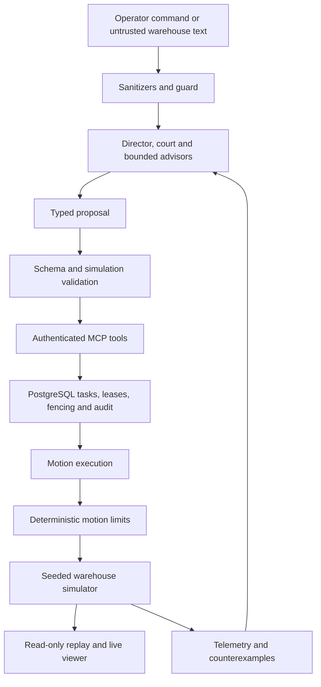

# Waggle Hive

**A safety and reliability control plane for LLM-directed warehouse robot fleets.**

Waggle Hive explores how language models can coordinate work in a warehouse shared
by robots, people and industrial machines while deterministic code retains control
of motion, permissions and resource ownership. It combines a seeded simulator,
a motion control layer, PostgreSQL coordination, an MCP tool boundary,
model-based task review, predictive maintenance and a 3D technical viewer.

Built by Agustin Diaz Cano for the **Meta Global AI Developer Hackathon 2026**,
**Indie Developer** track, **Push the Frontier** theme. Built with Muse Spark Open.

Status as of November 4, 2026: implemented components and development experiments,
with production integration and live model evaluations still pending. The recorded
viewer demo runs without provider credentials. It does not demonstrate the complete
voice-to-robot workflow.

[Try the viewer locally](#run-the-viewer) |
[Architecture](docs/ARCHITECTURE.md) |
[Measured results](#measured-results) |
[Hackathon requirements](#hackathon-requirements-and-evidence) |
[Submission checklist](SUBMISSION.md)

## The problem and the approach

A warehouse command such as "bring Z89 to the North Depot" requires more than a
plausible answer. The item must exist, the caller must have permission, a robot
must own the task and corridor, and its motion must account for people and
occluded space. A worker crash or an instruction hidden in a package label must
not create a second owner or grant new permissions.

**LLMs propose, deterministic code disposes.** Models interpret context and propose
actions. Code validates those actions, authenticates tool access and limits motion.
The safety advisor can add caution; it cannot relax a stopping limit. A rejected,
ambiguous or failed model decision escalates rather than granting permission.

The intended operator workflow is:

1. Screen text, a voice transcript or a package label as untrusted input.
2. Resolve the task and review it through the unanimous model court.
3. Validate the proposal and claim tasks and corridors with leases and fencing tokens.
4. Execute authorized tools through MCP while the deterministic control layer limits motion.
5. On a machine fault, restrict the hazard area and prepare diagnosis, parts and technician work.
6. On a blocked plan, test proposed alternatives in simulator forks and return counterexamples.
7. Inspect recorded state, safety overlays and events in the viewer.

This is the integration target. The following table identifies what exists today.

## Architecture and implementation



The diagram shows component responsibilities and intended integration. It does not
claim that every arrow is wired into one deployed service.

| Component | Implemented behavior | Evaluation or integration remaining |
|---|---|---|
| Simulator and sensing | Seeded floor-plane dynamics, snapshot/fork, exact collision detector, simulated 2D lidar, scripted/adversarial humans and machine telemetry | Simulation only; no physical robot validation |
| Fast control | Stopping-distance envelopes, separation checks, occlusion caps, CPA restriction, geofences, watchdog and e-stop | E1 development results expose remaining collisions and throughput loss; limits are not calibrated |
| Coordination | Aisle routing, atomic corridor reservations, leases, fencing, task dependencies, crash recovery and handoff records | Full E2 chaos campaign and trusted physical handoff integration |
| MCP boundary | Token-derived chassis identity, tool allowlists, strict physical bounds, persistent rate limits, audit and tool backends | SDK interoperability test uses a fake dispatcher; production deployment validation remains |
| Guard and court | Sanitizers, fail-closed classifier adapter, strict review schemas, unanimous court, role checklists and E3/E4 harnesses | Reviewed labels, live provider evaluation and production court integration |
| Robot advisors and organizer | Caution-only advisor, structured organizer, bounded runtime adapters and E5 configurations through C3/replay | Production service/call-log wiring and C4 fleet planner |
| Crisis replanning | Belief state, human variants, rollout aggregation, bounded counterexample loop and LLM proposer adapter | E10 harness, production caller and live evaluation |
| Predictive maintenance | Degradation/telemetry, alert loop, failure-history generator/loader, diagnosis sheet, parts/catalog checks and mock E6 chain | Database-backed production diagnosis, real catalog review and evaluation |
| Voice and vision | Typed intent/read-back and visual verification contracts, mock E7 paths and configured model roles | Real transcription/image provider integration, recordings and operator UI |
| Viewer | Replay playback, camera controls, map geometry, envelopes, lidar shadows, ghost paths, live WebSocket client and model gallery | Visual review and complete operator workflow; GLBs are distributed separately |

Implementation status is based on the source in [src/waggle](src/waggle),
[tests](tests) and [web](web). An implemented harness is not an experiment result.
See [PENDING.md](PENDING.md) for the remaining work and
[docs/THREAT_MODEL.md](docs/THREAT_MODEL.md) for residual risks.

## Where Meta models contribute

Model roles are explicit in [routes.toml](src/waggle/llm/routes.toml). Model ids come
from configuration, not from model-generated routing decisions. This is the
configured design; it is not evidence that every provider has been exercised.

| Route | Roles | Current boundary |
|---|---|---|
| Meta Model API, Muse Wonder (`META_WONDER_MODEL_ID`) | Director, crisis planner and diagnosis | Produces proposals; production callers are incomplete |
| Meta Model API, Muse Spark (`META_MODEL_ID`) | Court member 1 and vision | Strict review/vision contracts; live evaluation pending |
| Baseten, Muse Spark Open (`BASETEN_MODEL_ID`) | Court member 2, robot advisors and organizer | Bounded adapters; evaluated flows currently use mocks/scripted outputs |
| Modal, Muse Glimmer (`MODAL_GLIMMER_MODEL_ID`) | Guard and court member 3 | Classifier/reviewer roles; live evaluation pending |
| Meta Model API, Muse Voice Transcribe (`META_VOICE_MODEL_ID`) | Voice transcription | Provider integration and recordings pending |
| Modal Spark Open / Vertex AI | Explicit fallback routes; Vertex is also planned for the cross-family E4 comparison | Vertex integration and cross-family evaluation pending |

The three primary court members are related Meta models. Unanimity does not imply
independent errors. E4 must report false approvals first and reviewer correlation.
Fallbacks are logged and disabled in held-out evaluations so the measured court
composition matches the declared configuration.

The `mock` provider supports tests without network access or spend. Real calls
require configured credentials, verified pricing and spending limits. Missing or
invalid caps fail closed. See [provider integration](docs/PROVIDER_INTEGRATION.md).

## Measured results

These are historical development results at the commits recorded in their files,
not measurements of the latest HEAD. There are no held-out results published here.
Full protocols, baselines and limitations are in [docs/EXPERIMENTS.md](docs/EXPERIMENTS.md).

### E1: safety versus progress

Ninety runs per configuration, development seeds, commit `94bacc41a4`.
The selected rows below come from the [E1 report](results/e1/dev/report.md), which
links the configuration names to the committed result set in [results/e1/dev](results/e1/dev).
Intervals are Wilson 95% intervals for runs with a human collision; collision
episodes are not independent samples.

| Configuration | Runs with human collision (95% interval) | Human collisions | Robot collisions | Separation violations | Throughput / no control |
|---|---|---|---|---|---|
| No control | 62/90 (58.7% to 77.5%) | 107 | 1027 | 125 | 1.00 |
| Lidar envelope | 11/90 (7.0% to 20.6%) | 38 | 0 | 63 | 0.11 |
| Envelope + occlusion + CPA | 12/90 (7.8% to 21.9%) | 46 | 0 | 62 | 0.23 |

The baseline file, [no_control_20261030T173638Z.json](results/e1/dev/no_control_20261030T173638Z.json),
records 107 human collisions and 1027 robot collisions.

The controls reduce observed collisions against the baseline but do not eliminate
human collisions. Adding occlusion and CPA did not improve the human-collision
count over the lidar envelope in this run. Throughput falls substantially.
The report includes all ablations, failing seeds, false stops and latency.
E1 disables the watchdog, geofence and e-stop reflex limits to isolate the compared
configurations; it does not evaluate the complete deployed safety stack.

The earlier [sim_speed_20261030T121253Z.json](results/e8/dev/sim_speed_20261030T121253Z.json)
records 12.2 s per rollout with exact lidar and 5.8 s with rollout lidar. These
are code speed on this machine, not a hardware performance claim.

### Other recorded measurements

| Experiment | Recorded result | Scope and evidence |
|---|---|---|
| E2 admission | Both robot routes complete in 0/5 runs without admission and 5/5 with admission; Wilson 95% intervals 0% to 43.4% and 56.6% to 100% | Small sample, fixed S03 geometry with sensor/odometry noise. Zero robot collisions and occupancy violations in both arms. [Result JSON](results/e2/dev/s03_admission_f1b26ea3f5c7_20261101T185947Z.json). This does not test killed workers or the full database chaos protocol |
| E8 rollout speed | Median 18.0 s before and 5.7 s after, about 3.1x | Four alternating measurements on one machine, 10 robots and 4 humans, 45 simulated seconds. Targets of 2.0 s and 5x were missed. [Result JSON](results/e8/dev/before_after_20261030.json). Simulator code speed, not hardware real-time performance |
| E9 planted defects | 4/4 declared defects detected; none survived | Lowered margin, speed-raising cap, accepted stale scan and inverted fencing comparison. [Result JSON](results/e9/dev/planted.json). Four selected regressions, not a general mutation score |

| Evaluation | Publication status |
|---|---|
| E2 full chaos | Harness/workflow implemented, no full campaign result committed |
| E3 injection matrix | Layer runners implemented; no live-model result committed |
| E4 court | Scripted evaluation paths; no live court or cross-family result committed |
| E5 advisors/organizer | Mock/replay harnesses; no live benefit measurement committed |
| E6 maintenance | Mock chain; no measured predictive benefit committed |
| E7 multimodal | Mock contracts; no transcription/vision accuracy result committed |
| E8 provider cost and latency | Report/extrapolation tooling implemented; production collection/calibration pending |
| E9 mutation-tool campaign | Pending cloud execution |
| E10 crisis replanning | Loop/proposer implemented; harness and evaluation pending |

The [E8 runner](docs/E8_RUNNER.md) separates measured control code latency,
metadata-only model call summaries and assumed fleet extrapolation. Thousands of
agents would be an extrapolation, never a measured real-fleet claim.

## Hackathon requirements and evidence

The [official event page](https://dev.meta.ai/events/global-hackathon) identifies
Indie Developer and Push the Frontier, describes Meta API/open-weight use, and
lists creativity, technical ambition and working behavior for the Indie track.
It lists submission on November 4 at 9 PM ET. These public descriptions are distinct
from the accepted participant rules. The linked rules/waiver page could not be
read during this audit; final eligibility and delivery checks remain with the
maintainer. Checked November 4, 2026.

| Requirement or delivery check | Status | Evidence and remaining action |
|---|---|---|
| Indie Developer track | Declared fit | Solo project by Agustin Diaz Cano; participant registration/acceptance is an organizer-side check |
| Push the Frontier theme | Demonstrated scope fit | Robotics/manufacturing simulation, constrained model actions, fault recovery and measurable ablations |
| Use Meta models | Integrated in code; live evidence pending | Meta routes, prompts and adapters exist. Mock tests do not establish successful real-model use; record an authorized cloud run before marking this complete |
| Creativity and technical ambition | Evidence available for judges | Simulation forks, counterexample replanning, restrictive advisors and transactional tool execution; judging outcome is not claimed |
| Working behavior | Partial, reproducible evidence | Recorded viewer demo, tests and development results above; full live operator workflow remains incomplete |
| Work built during the hackathon | Declared and traceable | [PRIOR_WORK.md](PRIOR_WORK.md) declares a new repository from October 27 and no copied prior code; Git history provides reviewable provenance |
| Public source and reproduction | Source/instructions present; logged-out access check pending | Verify repository visibility and a fresh clone using the submission checklist |
| AI tools, dependencies and prior work disclosed | Documented | Disclosure below, pinned dependencies and prior-work declaration |
| Asset rights and model attribution | Partial | Attribution notice present. [ASSETS.md](ASSETS.md) still has missing provenance fields; confirm license wording and video attribution |
| Demo video, live link and submission form | Pending delivery | [SUBMISSION.md](SUBMISSION.md) tracks the video, live product, contributor list, access checks and final submission |

This table distinguishes source-backed project evidence from participant and
submission checks. It does not assert complete hackathon compliance. The public
page does not provide final rubric weights; the application scoring weights are
not the final project judging rubric.

## Repository safeguards

[tools/](tools) contains CI helpers and agent hooks. Hooks and CODEOWNERS are a
weak control: they help enforce review rules but depend on repository settings.
Required review and branch protection on main remain maintainer responsibilities.
Agents work on task branches and open PRs; the maintainer reviews and merges.

## Run the viewer

Requirements: Python 3.12 and [uv](https://docs.astral.sh/uv/) for Python checks;
Node 24 and npm for the viewer. Docker/PostgreSQL are needed for persistent
coordination, not for recorded playback. Run from the repository root:

```powershell
uv sync --frozen
uv run replay-verify web/public/demo.jsonl --digest-only
cd web
npm ci
npm run dev -- --host 127.0.0.1 --port 5174 --strictPort
```

Open [the recorded demo](http://127.0.0.1:5174/?demo=1). Play, pause, seek,
orbit/pan, select an entity and inspect available state/overlays. The fixture is
S01 development seed 7, labeled `fixture0`; it is a replay example, not a measured
LLM run. It does not contain every safety overlay. The digest-only command checks
file integrity. Resimulation against the current code differs at tick 4, so the
fixture is not a current simulator regression reference.

Open [the model gallery](http://127.0.0.1:5174/?gallery=1) for asset inspection.
GLBs are excluded from Git and require the separate archive plus the hash-checking
importer described in [web/README.md](web/README.md). Without them, playback uses
primitive geometry and the gallery reports unavailable models.

Live viewing is implemented via `/ws/live`. Start the Python API with
`uv run python -m waggle.api` from the root, and serve/proxy the viewer's
`/ws/live` path to that API before using `?live=S01`. The standalone Vite command
above does not configure that proxy. The API is read-only, has no authentication
and binds to localhost by default; this is a local development viewer setup.

## Verify and reproduce

```powershell
uv run pytest tests/unit/test_docs_content.py tests/unit/test_docs_consistency.py tests/unit/test_style.py -q
uv run lint
uv run type
uv run ci
```

`uv run ci` runs Ruff, strict mypy, the light pytest suite with coverage and import
contracts. It excludes `heavy` and `llm` identically to regular CI. Run the full
suite in GitHub Actions; local work uses targeted quick checks. The current
pre-push gate still requires a green `uv run ci` stamp on HEAD.

For the frontend, from `web/`, run `npm test` and `npm run build`. Browser checks
and model-pack checks are described in [web/README.md](web/README.md).

Rebuild the committed E1 summary without a model call using `uv run report`.
Development sweeps run in [.github/workflows/e1.yml](.github/workflows/e1.yml);
PostgreSQL correctness checks run in [postgres.yml](.github/workflows/postgres.yml),
and long/paid tests in [heavy.yml](.github/workflows/heavy.yml).
See [docs/E8_RUNNER.md](docs/E8_RUNNER.md) for latency/report commands.
Only the maintainer commits cloud result artifacts. `uv run experiments-test` is
still a placeholder and must not be treated as a held-out evaluation.

## Persistent services and configuration

The package includes PostgreSQL repositories, worker entry points and the stdio
MCP server (`uv run python -m waggle.mcp_server`). These require explicit database,
identity, map and runtime configuration. Compose is development scaffolding,
not a one-command demonstration of the complete product.

Migrations never run on service startup. Inspect the target database with
`uv run python -m waggle.db.schema` before an approved migration. The current
schema is revision 14; do not follow old revision-2 setup instructions.
Provision sample data separately with `uv run provision SPEC TOKENS_OUT`, using
[data/provision/example.json](data/provision/example.json) as a format reference.
Tokens are written to a new file rather than printed.

## Environment variables


Names only live in `.env.example`. Values go in `.env`, which git ignores.

| Variable | Description | Default |
|---|---|---|
| `WAGGLE_LLM_PROVIDER` | Provider mode: `mock` or `http`; unset fails closed | none |
| `META_API_KEY`, `META_API_BASE_URL` | Meta Model API access | none |
| `META_MODEL_ID`, `META_WONDER_MODEL_ID`, `META_VOICE_MODEL_ID` | Model ids, read from the API model list (`GET /v1/models`) | none |
| `META_USE_CONTRIBUTOR_TIER` | Use the cheaper contributor tier. Allowed only because all data is synthetic | false |
| `BASETEN_API_KEY`, `BASETEN_MODEL_ID` | Baseten access and the Muse Spark Open 1026 id | none |
| `MODAL_TOKEN_ID`, `MODAL_TOKEN_SECRET`, `MODAL_ENDPOINT_URL` | Modal access and endpoint | none |
| `MODAL_GLIMMER_MODEL_ID`, `MODAL_SPARK_OPEN_MODEL_ID` | Model ids served on Modal (guard and court member 3; fallback host for Muse Spark Open) | none |
| `VERTEX_PROJECT_ID`, `VERTEX_LOCATION`, `VERTEX_MODEL_ID`, `GOOGLE_APPLICATION_CREDENTIALS` | Vertex AI backup, service account file | none |
| `META_SPEND_CAP_USD`, `BASETEN_SPEND_CAP_USD`, `MODAL_SPEND_CAP_USD`, `VERTEX_SPEND_CAP_USD` | Hard cap per provider in USD. A missing or invalid value blocks calls | none |
| `POSTGRES_USER`, `POSTGRES_PASSWORD`, `POSTGRES_DB`, `DATABASE_URL` | Database | none |
| `WAGGLE_MCP_TOKEN` | MCP server: chassis token, at least 32 characters | none, required |
| `WAGGLE_MCP_EXTENT` | MCP server: map rectangle `x_min,y_min,x_max,y_max` in meters | none, required |
| `WAGGLE_MCP_RATE_MAX_CALLS`, `WAGGLE_MCP_RATE_WINDOW_S` | MCP server: allowed intents per chassis in the window | none, required |
| `WAGGLE_MCP_TIMEOUT_S` | MCP server: per-call timeout, above 0 and at most 60 | none, required |
| `MESHY_API_KEY`, `LANGFUSE_*` | 3D assets and optional tracing | none |
| `WAGGLE_API_HOST`, `WAGGLE_API_PORT` | Read-only API bind address and port | `127.0.0.1`, `8000` |
| `WAGGLE_REPLAY_DIR`, `WAGGLE_API_LIVE_SEED`, `WAGGLE_COMMIT` | Replay directory and live-run provenance | `replays`, `0`, `unknown` |
| `WAGGLE_API_MAX_FPS`, `WAGGLE_API_STRIDE`, `WAGGLE_API_MAX_FRAME_BYTES` | Streaming limits | `30`, `1`, `262144` |
| `WAGGLE_IMAGE_TAG` | Tag of the service images in compose | dev |

## Third-party libraries and assets

Runtime dependencies are pinned in [pyproject.toml](pyproject.toml):

- numpy 2.5.4: simulator/control arrays and seeded random streams.
- psycopg[binary] 3.3.6: PostgreSQL persistence, with no ORM.
- fastapi 0.162.0 and uvicorn[standard] 0.54.0: read-only simulator/replay API.

The viewer uses TypeScript, Vite and three.js with pinned versions in
[web/package.json](web/package.json). Playwright is a development browser-test
dependency. The official MCP Python SDK (`mcp==2.3.0`) is development-only for
client interoperability tests; runtime code does not import it. httpx is also a
development test dependency. Python resolutions are pinned in the lockfile.

Model binaries and generated visuals have separate provenance; see
[ASSETS.md](ASSETS.md), [web/models.json](web/models.json) and the
[viewer asset workflow](web/README.md).

## Scope and limits

- Simulation only: 2D physics on the floor plane with 3D rendering. Height is not modeled.
  Telemetry, manuals and failure history are synthetic; humans are scripted/adversarial.
  The lidar is simulated. Vision is not in the control loop. No physical robot validation.
- Deterministic reproduction requires the same platform and numpy version.
  The published E1 cloud run used Linux; result files identify their platform and commit.
- Simulation validation and unanimous model review are not formal verification or safety proofs.
  The stopping/separation approach does not imply standards compliance or certification.
- Control timings are code latencies inside a simulator, not hardware real-time guarantees.
- Remaining integration includes production court/advisor/diagnosis services,
  multimodal providers, the fleet planner, package consistency checks and E10 evaluation.
- [Multi-warehouse logistics](docs/MULTI_WAREHOUSE_PLAN.md) is a planned extension,
  not implemented or evaluated as part of the local system described here.

## Repository guide

| Path | Purpose |
|---|---|
| [src/waggle](src/waggle) | Simulator, control, coordination, DB, MCP, governance, LLM, validation, maintenance, multimodal, replay and API |
| [web](web) | Read-only 3D viewer, gallery and browser checks |
| [tests](tests) | Unit, property, integration and cloud-only checks |
| [results](results) | Committed experiment evidence |
| [docs/EXPERIMENTS.md](docs/EXPERIMENTS.md) | E1 to E10 protocols, baselines and reporting rules |
| [docs/DECISIONS.md](docs/DECISIONS.md) | Architecture decisions and superseded designs |
| [PLAN.md](PLAN.md), [PENDING.md](PENDING.md) | Build order and remaining work |
| [AGENTS.md](AGENTS.md) | Development, safety and review rules |
| [SUBMISSION.md](SUBMISSION.md) | Final delivery checklist |

## Disclosure

| Area | Detail |
|---|---|
| Author | Agustin Diaz Cano, solo maintainer |
| AI development tools | Claude Code, Codex and Antigravity assisted with code, tests, research and documentation under maintainer review |
| Product models | Configured Meta Muse Wonder, Muse Spark, Muse Spark Open, Muse Glimmer and Muse Voice Transcribe roles; Vertex is a declared backup/comparison route. Integration status is listed above |
| Prior code and ideas | No prior code copied or adapted, as declared in [PRIOR_WORK.md](PRIOR_WORK.md); earlier related ideas are disclosed there |
| Assets | Generated assets and synthetic source documents; provenance and outstanding rights records in [ASSETS.md](ASSETS.md) |
| Measurements | Only committed result files support the numbers in this README; mocks and example replays are labeled |

## Model license notice

Built with Muse Spark Open. The project retains this attribution notice in the
README and viewer. Exact model-license wording and the video end card still need
maintainer verification; the notice alone is not a license-compliance assessment.

## License

Project code: [MIT](LICENSE). Model and asset licenses apply separately.
