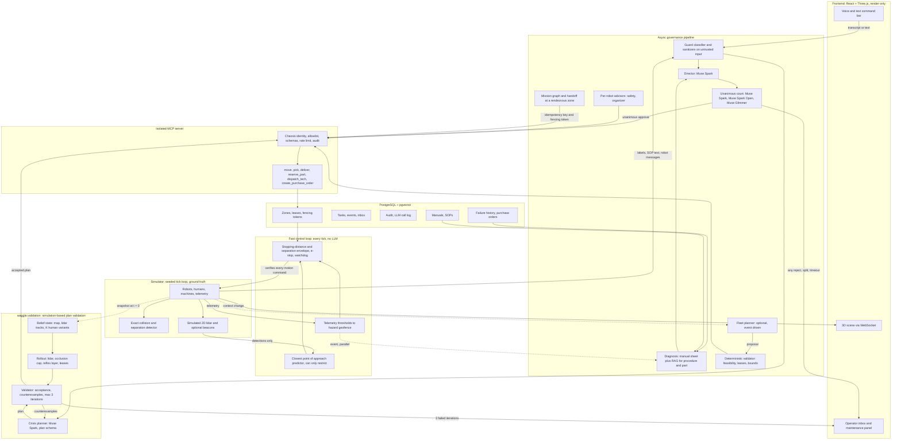

# Waggle Hive: Architecture

## Principles

1. LLMs propose, deterministic code disposes.
2. Authority comes from authenticated identity, never from prompt or retrieved text.
3. The fast layer can only reduce motion. Nothing above it can widen what it allows.
4. Fail closed on safety and untrusted input. Degrade to a safe hold when an LLM is unavailable.
5. The simulator owns ground truth. The renderer owns nothing.
6. Every claim is backed by a seeded, reproducible script.

## Components

## Sensing and prediction

Designed, not implemented (ADR-018).

- The simulator owns ground truth. Robots perceive through a simulated 2D lidar: rays against walls, racks and moving entities, with range, angular resolution, noise, dropout and occlusion, all seeded. Optional human beacons are visible around corners.
- Lidar defaults (assumptions to calibrate, `waggle.sim.sensors.LidarConfig`): 10 Hz (every 4 ticks), 360 rays, 12 m maximum range, range noise sigma 0.02 m, dropout probability 0.01. A ray with no return gives the maximum range, a dropped ray gives NaN. The scan is a pure function over geometry arrays, with one noise draw and one dropout draw per ray whatever the geometry. Odometry adds seeded noise to the pose and speeds. The human beacon variant (off by default) reports positions with noise and a delay, without occlusion.
- The fast layer reads detections only. The exact detector in the simulator keeps using ground truth for scoring.
- Predictor: constant velocity extrapolation of each detected object and the closest point of approach (time and distance), compared with the robot's stopping distance. A predicted conflict lowers the speed cap earlier. It never raises it. The worst-case separation envelope is the floor.
- Failure mode: a missing or stale scan assumes the worst case and the watchdog stops the robot. No learned model. Camera and vision are not in the control loop.

## Missions and handoff

Designed, not implemented (ADR-019).

- A mission is a small task graph with dependency edges. A dependent task is eligible only when its predecessors are done.
- A handoff happens at a rendezvous zone with capacity one, held by a lease with a fencing token. The handoff event carries an idempotency key, so the dependent task becomes eligible exactly once.
- If the carrier dies, the lease expires, the task is reassigned and the fencing check rejects the stale carrier.
- Inter-robot messages use a fixed schema, are screened as untrusted and are bounded.

## Control path versus governance path

Governance path (slow, seconds): command, screening, director, court, MCP, lease, motion command.
Control path (fast, every tick): every motion command, from any source, passes through the envelope and can be reduced or vetoed. Telemetry thresholds act on this path directly, without any LLM or retrieval.

## Simulator module layout

`waggle.sim` modules (control may import only `params` and `observations`, see ADR-021):

| Module | Role |
|---|---|
| `state` | Contiguous numpy arrays, tick, snapshot, canonical hash |
| `streams` | Seeded random streams per subsystem and entity |
| `engine` | Fixed-step tick loop, fork |
| `world` | Map, walls, racks, aisles, one-lane aisles, blind corners, stations, depots, JSON format |
| `params` | Frozen dataclasses with robot class parameters (leaf) |
| `observations` | LidarScan, RobotOdometry, BeaconReport (leaf) |
| `robots` | Four classes, kinematics, actuation delay, swept footprint polygon |
| `humans` | Scripted, random walker and adversarial humans, hidden-human variant sampling |
| `detector` | Exact collision and separation-violation detector on ground truth |
| `sensors` | Lidar as a pure function over geometry arrays, beacon variant, odometry noise |
| `scenarios` | Scenario format, generators S01 to S18, seeds, replay |
| `scripted` | Waypoint-following driver for the no-control baseline and scripted entities, no safety logic |

## Control module layout

Designed, not implemented (ADR-026 to ADR-028). `waggle.control` imports only `waggle.sim.params` and `waggle.sim.observations`. Every function is pure with explicit state.

| Module | Role | Branch |
|---|---|---|
| `types` | `ControlInputs`, `ControlOutput`, `ControlState`, reason enum | B12 |
| `params` | Control assumptions (gaps, gates, margins, `k`), frozen dataclasses | B12 |
| `envelope` | `S_stop`, `S_sep`, swept path distance, speed cap, reflex stop | B12 |
| `arbiter` | Minimum over all limits, curvature preserving scaling, reasons | B12 |
| `perception` | Scan validation, NaN handling, clusters, size class | B13 |
| `tracking` | Association, velocity estimate, coasting | B13 |
| `occlusion` | Phantom human cap from occlusion boundaries (ADR-024) | B14 |
| `cpa` | Constant velocity closest point of approach, can only restrict | B15 |
| `reflex` | Heartbeat, geofences, e-stop, telemetry threshold | B16 |

## Fast layer

Parameters per robot class (simulator assumptions, to be calibrated and documented):

| Class | Max speed (m/s) | Decel (m/s^2) | Actuation delay (s) | Delay (ticks at 40 Hz) | Footprint (length x width, m) |
|---|---|---|---|---|---|
| carrier | 2.0 | 2.0 | 0.10 | 4 | 1.2 x 0.8 |
| forklift | 1.5 | 0.8 | 0.15 | 6 | 2.4 x 1.1 |
| parts runner | 1.8 | 1.5 | 0.10 | 4 | 0.9 x 0.6 |
| tech repair | 1.2 | 1.5 | 0.10 | 4 | 0.8 x 0.6 |

Footprints are assumptions to calibrate. The human footprint is a disc of radius 0.30 m by default.

Kinematics are non-holonomic (assumptions to calibrate, no claim of any standard):

| Class | Model | Parameter |
|---|---|---|
| forklift | bicycle model | minimum turning radius 2.5 m, wheelbase 1.6 m, maximum steering angle 0.569 rad |
| carrier | differential drive | maximum angular speed 1.5 rad/s |
| parts runner | differential drive | maximum angular speed 1.8 rad/s |
| tech repair | differential drive | maximum angular speed 1.2 rad/s |

The footprint is an oriented rectangle that sweeps along the curved path. The detector uses the swept footprint. A robot cannot exceed its minimum turning radius or maximum angular speed, so a forklift at full speed cannot clear a blind corner that a carrier can.

Optional forklift parameter `load_raised`: multiplies max speed by 0.6 and the decel limit by 0.7. Both factors are assumptions to calibrate.

## Route planner

Deterministic, no LLM (designed, not implemented). A* on the aisle graph with a fixed tie-break. One-lane aisles are zones with capacity one, reserved through leases with fencing tokens. A robot that cannot get a lease waits or replans. A deadlock counter is reported in E2.

Formulas:
- Stopping distance: `S_stop = v*t_r + v^2/(2a)`.
- Separation to a human: `S_sep = v_h*(t_r + v/a) + S_stop + C`, with `v_h` the assumed human approach speed and `C` a margin.
- Speed cap: full speed at `d >= k*S_sep`, linear to zero at `d <= S_sep`, e-stop below `S_sep`.
- Heartbeat: no heartbeat within the timeout means stop.
- Hazard geofence: polygon that motion commands may not enter, set statically or dynamically (machine fault, spill, human zone).

Inspired by speed and separation monitoring. No compliance with any standard is claimed.

## Crisis replanning

Designed, not implemented (ADR-023, ADR-024, ADR-025). Package `waggle.validation`, created in Phase 5C. It may import `waggle.sim` and `waggle.control`, never `waggle.llm`, `waggle.governance` or `waggle.mcp_server`. `waggle.sim` and `waggle.control` never import it. Runtime dependencies there: numpy and the standard library.

- Planner: Muse Spark with a structured world summary, retrieved SOP excerpts (fenced as untrusted data), an optional obstacle class from vision, and the operator request or a text incident report. It proposes a plan in the schema below.
- Belief state: the static map, the entities tracked from lidar at t = 0, and K seeded human variants (default K = 5) including humans inside initially occluded regions. A variant that puts a human inside the minimum stopping distance of a robot at t = 0 is rejected at sampling.
- Rollout: the same dynamics, 10 Hz simulated lidar against the belief state, the dynamic occlusion cap, the fast reflex layer and in-memory lease logic, over H simulated seconds (default 45). Occlusion boundaries are recomputed from the simulated pose at every lidar tick.
- Validator: accepts a plan only if all K rollouts show no collision, separation violation, geofence intrusion, deadlock or lease conflict, the route is feasible, every active robot makes strict progress, and the end state is recoverable. Otherwise it returns counterexamples (COLLISION, SEPARATION_VIOLATION, GEOFENCE_INTRUSION, CORRIDOR_DEADLOCK, LEASE_CONFLICT, ROUTE_INFEASIBLE, NO_PROGRESS, UNSAFE_TERMINAL_STATE) in SI units. Maximum 3 iterations, then escalate and hold safely.
- Receding horizon: execute at most H/2, then revalidate from the new belief state.
- This is simulation-based plan validation with counterexample feedback. It is not formal verification. The reflex layer keeps running during execution.

## Plan schema

The contract between the LLM and the validator. Validation is hand-written on frozen dataclasses.

| Field | Rule |
|---|---|
| Plan: `mission_id` | Set by code |
| Plan: `nodes` | At most 20 |
| Plan: `rationale` | Free text, logged for the operator, never forwarded to another model |
| Plan: `escalate`, `escalation_reason` | Bool, and an enum or null |
| Node: `label` | Unique in the plan, for example "n1" |
| Node: `robot_id`, `item_id`, `target_zone_id` | Validated against the fleet, the inventory and the map in code |
| Node: `action` | MOVE, PICK, HANDOFF, DELIVER, DISPATCH_REPAIR |
| Node: `corridor_zone_ids` | Ordered capacity-1 corridor zones to traverse; empty only if the path uses open transit zones only |
| Node: `avoid_zone_ids` | Can only add avoidance; reflex-layer geofences always win |
| Node: `wait_for` | Existing labels, acyclic |
| Node: `speed_cap_mps` | Null or above zero and not above the class maximum; the effective speed is the minimum of the deterministic limit and the cap |

Unknown fields are rejected. Idempotency keys and global task ids are derived by code from the mission id and the node index and content, never produced by the model. Each node maps to MCP tool calls under that robot's chassis identity. The validator plans geometry with A* on the aisle graph, free through open transit zones, excluding `avoid_zone_ids`, and restricted from entering any capacity-1 corridor not listed in `corridor_zone_ids`. When no valid path exists it returns ROUTE_INFEASIBLE with the offending zone.

## Occlusion-aware speed cap

Designed, not implemented (ADR-024). For each occlusion boundary in the lidar scan, assume a phantom human at the nearest possible point approaching at `v_h`. The cap is the largest `v` such that `S_sep(v)` is at most the distance to the boundary along the swept curvilinear path. No non-negative root gives a cap of zero. Near zero speed a minimum speed floor is used. The cap runs in the fast layer and inside the rollout. Its cost is throughput, reported in E1.

## Prompt requirements

- Prompts are versioned files under `src/waggle/llm/prompts/`. The version is recorded in every result file.
- Code escapes closing tags before text enters a prompt.
- Free text derived from untrusted input is never forwarded to another model.
- Self-reported confidence is not a gate until it is calibrated in E7.
- Every prompt that reads untrusted text, the critics included, has the same untrusted-data boundary.
- The planner never produces ids, keys or physical parameters beyond the schema.

## Model tiers and roles

Every model role uses a Meta Muse model. Providers and fallbacks are declared in `src/waggle/llm/routes.toml`; model ids come from environment variables. See ADR-015, ADR-016 and ADR-017 in [DECISIONS.md](DECISIONS.md).

| Tier | Roles | Model and provider | Trigger |
|---|---|---|---|
| Reflex | Fast control loop, fencing | Deterministic code, no LLM | Every tick |
| Fast LLM | Per-robot safety advisor, per-robot organizer | Muse Spark Open 1026 on Baseten | Context change, never per tick |
| Fast LLM | Guard classifier | Muse Glimmer on Modal | Each untrusted input, after sanitizers |
| Planning LLM | Director, fleet planner, diagnosis, court member 1, voice, vision | Muse Spark on the Meta API | A command, an event, or every N seconds |
| Planning LLM | Court member 2 | Muse Spark Open 1026 on Baseten | Each reviewed task |
| Planning LLM | Court member 3 | Muse Glimmer on Modal | Each reviewed task |

Fallbacks, only through the routing table and disabled in held-out runs: Modal hosting Muse Spark Open when Baseten fails, and Vertex AI as secondary backup for the guard and court member 3.

Fleet planner (optional): event-driven and low frequency. It proposes assignments, batching and reroutes. A deterministic validator checks feasibility, leases and bounds before anything is applied. If the planner fails or times out, the deterministic assigner is used. In E5 it is an extra configuration; the code-only baseline stays.

Guard classifier: deterministic sanitizers run first (length, charset, delimiter escaping). The classifier returns a label (benign, injection or uncertain) and a reason code as strict structured output, with the input fenced as untrusted data. A parse failure, a timeout or uncertain rejects and escalates. It is the first screen, not the boundary. Identity and schemas are the boundary.

Budget: a guard in `waggle.llm` checks accumulated cost plus the call estimate against the provider cap before every call, and per-task call and cost caps apply.
## Leases and fencing tokens

Control keeps a local lease view (zone, token, expiry_tick) pushed by the coordination layer. It clamps speed before a zone with no valid grant and fails closed when the view is stale. The authoritative token check stays inside the tool (ADR-004). Control never reads the database. Lease expiry is stored in simulation ticks supplied by the caller; audit timestamps keep `clock_timestamp()`. Multi-zone corridors are acquired in one transaction with rows locked in canonical order. Zone state FAULT_OCCUPIED: the sweeper never releases a zone while the last known odometry puts a chassis in it. It marks the zone FAULT_OCCUPIED and triggers replanning.

- `zones(zone_id, holder, fencing_token, expires_at)`.
- Acquire: in one transaction, lock the row, check free or expired, increment the token, set holder and expiry.
- Every tool that acts on a zone receives `(zone_id, token)` and verifies in the same transaction with the row locked. A stale token is rejected.
- Expiry is handled by a sweeper using `FOR UPDATE SKIP LOCKED`. The token never decreases.
- One-lane aisles and stations are zones with capacity one. Deadlocks are resolved by acquisition order and timeout.

## Task state machine

`PENDING -> SCREENED -> REVIEWED -> APPROVED -> ASSIGNED -> EXECUTING -> DONE`
Side exits: `ESCALATED` (operator inbox), `REJECTED`, `FAILED`, `ABORTED`.
Each transition is an event row. Retries carry an attempt number and an idempotency key.

## MCP boundary

- Identity: each robot chassis has a token. Server stores SHA-256 hashes, compares in constant time, derives `chassis` and `robot_id` from the token.
- Allowlist: chassis to tools. Carrier cannot call forklift tools or maintenance tools.
- Schemas: strict, unknown fields rejected, physical bounds per chassis.
- Rate limit: counted from the audit table so it holds across replicas.
- Audit: intent row before forwarding (write fails means call denied). Result row after execution, linked by correlation id.
- Per-call timeout on the client so a denied request cannot hang it.
- Rate limit serialization: a transaction-scoped advisory lock on a 64-bit key per chassis (for example `hashtextextended`), taken before counting and held until the intent row is inserted. Test: 30 simultaneous calls from one chassis.

Tools: `move_waypoint`, `pick_package`, `deliver_package`, `release_zone`, `reserve_part`, `dispatch_tech`, `open_ticket`, `get_task`, `get_inventory`, `create_purchase_order` (designed, not implemented).

## Court

- Inputs: structured task, item resolution result, current world summary, relevant SOP excerpts (screened).
- Members: Muse Spark, Muse Spark Open 1026, Muse Glimmer (related models, correlated errors expected, see ADR-017). Same prompt, structured verdict with reason code.
- Decision: execute only if all three approve with no parse or timeout failure. Anything else goes to the operator inbox. No path approves over a rejection.
- Logged per call: model, tokens, latency, cost, verdict.

## Per-robot advisors

- Safety advisor: small and fast model. Input: local context. Output: restriction request only (lower speed cap, larger margin, pause). Applied by the fast layer as a further limit, never as a relaxation.
- Organizer: decides inside the assigned task. Output: structured action requests through MCP with that robot's identity. Messages between robots use a fixed schema, are screened as untrusted, and are bounded by turns and budget.

## Predictive maintenance

- Telemetry: temperature, vibration, hydraulic pressure, current per machine.
- Threshold path (fast, deterministic): limit crossing sets a hazard geofence and severity.
- Prediction path: first-order thermal model fit online, estimated time to limit.
- Manual sheet: structured JSON extracted once per machine and validated (limits, failure modes, part numbers, procedures). Missing sheet means conservative default.
- RAG: retrieves procedure text and part information, drafts the ticket. Part numbers are checked against the catalog in code before any order.
- Idempotency: one failure event key opens at most one ticket and one part reservation.

## Multimodal

- Voice: push-to-talk, Muse Voice Transcribe, transcript is untrusted, screened, resolved to an item id by code, id read back to the operator before execution.
- Vision: synthetic FPV render of the scene, Muse Spark with image verifies label and obstruction, result attached to the ticket.
- Alarms: browser audio by severity. Every feature has a text fallback.

## Data model (summary)

`robots`, `robot_identities`, `zones`, `tasks`, `task_events`, `machines`, `machine_telemetry` (sampled), `spare_parts`, `maintenance_tickets` (unique idempotency key), `failure_history` (synthetic, separate from the simulator dynamics), `purchase_orders` (unique idempotency key per failure event), `mcp_audit` (intent and result rows), `llm_calls`, `knowledge_chunks` (pgvector), `operator_inbox`.

## Observability

Structured logs, `llm_calls` table with tokens, latency, cost per call, per-task cost rollup. Optional tracing with Langfuse. Replay by seed.

## Deployment

Docker Compose on one VM for the live demo. Local `docker compose up` for development and for every experiment script.

## Rollout performance (Phase 2, B10)

Status: measured. All figures are code speed on this machine (a 4-core laptop CPU with throttling), not a real-time guarantee on hardware. Scenario S14 seed 1, 10 robots, 4 humans, 1800 ticks (45 s), 4500 lidar scans.

Profile before (cProfile, exact lidar, commit 3ce1c3e), own time by component: core 3.0 s, detector 7.4 s, lidar 6.4 s, other 3.4 s. Profiled total 20.1 s.

| Top functions before | Component | Calls | Own seconds |
|---|---|---|---|
| sensors.py:82(_cross) | lidar | 13590 | 3.32 |
| detector.py:238(_check) | detector | 1810 | 2.57 |
| detector.py:51(_point_segment) | detector | 112600 | 2.06 |
| sensors.py:114(lidar_scan) | lidar | 4530 | 1.34 |
| sensors.py:86(_segment_hits) | lidar | 4530 | 1.19 |
| robots.py:136(footprint_corners) | core | 61178 | 1.11 |
| detector.py:66(_orient) | detector | 426324 | 1.10 |
| ~:0(<built-in method numpy.array>) | other | 237107 | 0.75 |

Profile after (fast lidar), own time by component: core 1.4 s, detector 2.1 s, lidar 2.8 s, other 2.3 s. Profiled total 8.6 s.

| Top functions after | Component | Calls | Own seconds |
|---|---|---|---|
| sensors.py:82(_cross) | lidar | 8601 | 0.84 |
| sensors.py:86(segment_hits) | lidar | 2867 | 0.66 |
| detector.py:264(_robot_contacts) | detector | 1810 | 0.51 |
| ~:0(<method 'reduce' of 'numpy.ufunc' objects>) | other | 18376 | 0.50 |
| fastlidar.py:145(_box_distances) | lidar | 453 | 0.37 |
| humans.py:61(_edge_distance) | core | 21640 | 0.32 |
| sensors.py:146(finish_scan) | lidar | 4530 | 0.31 |
| hullgap.py:38(_edges) | detector | 1759 | 0.30 |

Result files: `results/e8/dev/profile_*.json` and `results/e8/dev/before_after_20261030.json`.

Measured speed, four alternating runs in one session: before 16.7 to 24.6 s (median 18.0 s), after 5.6 to 7.1 s (median 5.7 s). Speedup 3.1x by median and 3.0x by minimum. The same rollout varied between 3.6 s and 8.9 s inside one session, so single figures are not comparable across sessions. K = 5 variants in 5 processes took 14.0 s against 23.9 s serial (1.7x): the CPU has 4 physical cores and each job slowed from about 4.5 s to 13 s when five ran together.

Targets (not claims): 2.0 s per rollout and about 5 s for K = 5. Both are missed. The minimum speedup of 5x is missed, so work stops here for the maintainer's decision (see ADR-025).
