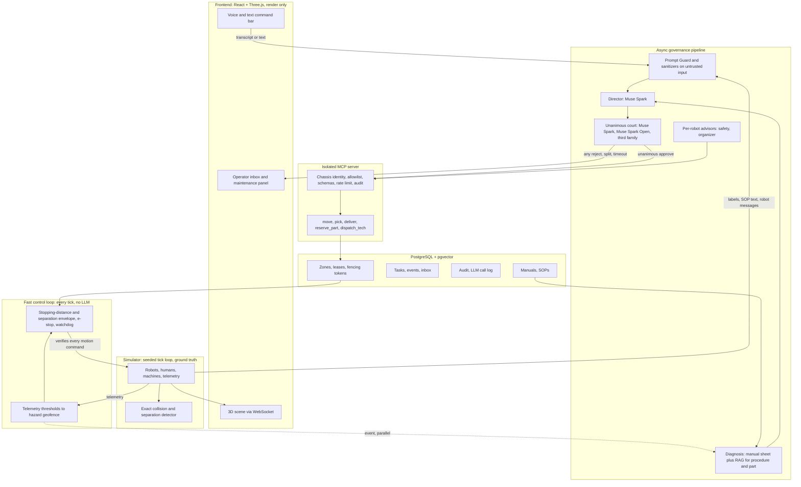

# Waggle Hive: Architecture

## Principles

1. LLMs propose, deterministic code disposes.
2. Authority comes from authenticated identity, never from prompt or retrieved text.
3. The fast layer can only reduce motion. Nothing above it can widen what it allows.
4. Fail closed on safety and untrusted input. Degrade to a safe hold when an LLM is unavailable.
5. The simulator owns ground truth. The renderer owns nothing.
6. Every claim is backed by a seeded, reproducible script.

## Components

## Control path versus governance path

Governance path (slow, seconds): command, screening, director, court, MCP, lease, motion command.
Control path (fast, every tick): every motion command, from any source, passes through the envelope and can be reduced or vetoed. Telemetry thresholds act on this path directly, without any LLM or retrieval.

## Fast layer

Parameters per robot class (simulator assumptions, to be calibrated and documented):

| Class | Max speed (m/s) | Decel (m/s^2) | Actuation delay (s) |
|---|---|---|---|
| carrier | 2.0 | 2.0 | 0.10 |
| forklift | 1.5 | 0.8 | 0.15 |
| parts runner | 1.8 | 1.5 | 0.10 |
| tech repair | 1.2 | 1.5 | 0.10 |

Formulas:
- Stopping distance: `S_stop = v*t_r + v^2/(2a)`.
- Separation to a human: `S_sep = v_h*(t_r + v/a) + S_stop + C`, with `v_h` the assumed human approach speed and `C` a margin.
- Speed cap: full speed at `d >= k*S_sep`, linear to zero at `d <= S_sep`, e-stop below `S_sep`.
- Heartbeat: no heartbeat within the timeout means stop.
- Hazard geofence: polygon that motion commands may not enter, set statically or dynamically (machine fault, spill, human zone).

Inspired by speed and separation monitoring. No compliance with any standard is claimed.

## Leases and fencing tokens

- `zones(zone_id, holder, fencing_token, expires_at)`.
- Acquire: in one transaction, lock the row, check free or expired, increment the token, set holder and expiry.
- Every tool that acts on a zone receives `(zone_id, token)` and verifies in the same transaction with the row locked. A stale token is rejected.
- Expiry is handled by a sweeper using `FOR UPDATE SKIP LOCKED`. The token never decreases.
- One-lane aisles and stations are zones with capacity one. Deadlocks are resolved by acquisition order and timeout.

## Task state machine

`PENDING -> SCREENED -> REVIEWED -> APPROVED -> ASSIGNED -> EXECUTING -> DONE`
Side exits: `ESCALATED` (operator inbox), `REJECTED`, `FAILED`, `ABORTED`.
Each transition is an event row. Retries carry an attempt number and an idempotency key.

## MCP boundary

- Identity: each robot chassis has a token. Server stores SHA-256 hashes, compares in constant time, derives `chassis` and `robot_id` from the token.
- Allowlist: chassis to tools. Carrier cannot call forklift tools or maintenance tools.
- Schemas: strict, unknown fields rejected, physical bounds per chassis.
- Rate limit: counted from the audit table so it holds across replicas.
- Audit: intent row before forwarding (write fails means call denied). Result row after execution, linked by correlation id.
- Per-call timeout on the client so a denied request cannot hang it.

Tools: `move_waypoint`, `pick_package`, `deliver_package`, `release_zone`, `reserve_part`, `dispatch_tech`, `open_ticket`, `get_task`, `get_inventory`.

## Court

- Inputs: structured task, item resolution result, current world summary, relevant SOP excerpts (screened).
- Members: Muse Spark, Muse Spark Open 1026, third family. Same prompt, structured verdict with reason code.
- Decision: execute only if all three approve with no parse or timeout failure. Anything else goes to the operator inbox. No path approves over a rejection.
- Logged per call: model, tokens, latency, cost, verdict.

## Per-robot advisors

- Safety advisor: small and fast model. Input: local context. Output: restriction request only (lower speed cap, larger margin, pause). Applied by the fast layer as a further limit, never as a relaxation.
- Organizer: decides inside the assigned task. Output: structured action requests through MCP with that robot's identity. Messages between robots use a fixed schema, are screened as untrusted, and are bounded by turns and budget.

## Predictive maintenance

- Telemetry: temperature, vibration, hydraulic pressure, current per machine.
- Threshold path (fast, deterministic): limit crossing sets a hazard geofence and severity.
- Prediction path: first-order thermal model fit online, estimated time to limit.
- Manual sheet: structured JSON extracted once per machine and validated (limits, failure modes, part numbers, procedures). Missing sheet means conservative default.
- RAG: retrieves procedure text and part information, drafts the ticket. Part numbers are checked against the catalog in code before any order.
- Idempotency: one failure event key opens at most one ticket and one part reservation.

## Multimodal

- Voice: push-to-talk, Muse Voice Transcribe, transcript is untrusted, screened, resolved to an item id by code, id read back to the operator before execution.
- Vision: synthetic FPV render of the scene, Muse Spark with image verifies label and obstruction, result attached to the ticket.
- Alarms: browser audio by severity. Every feature has a text fallback.

## Data model (summary)

`robots`, `robot_identities`, `zones`, `tasks`, `task_events`, `machines`, `machine_telemetry` (sampled), `spare_parts`, `maintenance_tickets` (unique idempotency key), `mcp_audit` (intent and result rows), `llm_calls`, `knowledge_chunks` (pgvector), `operator_inbox`.

## Observability

Structured logs, `llm_calls` table with tokens, latency, cost per call, per-task cost rollup. Optional tracing with Langfuse. Replay by seed.

## Deployment

Docker Compose on one VM for the live demo. Local `docker compose up` for development and for every experiment script.
