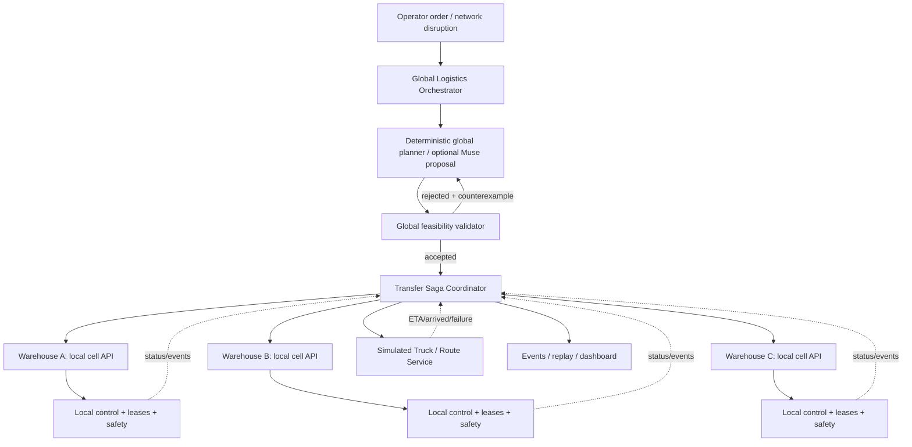

# Waggle Hive: Multi-warehouse logistics plan
## Planning specification for a network of Waggle cells

Status: planned extension, not implemented or evaluated. Updated: 2026-10-31. Owner: maintainer. Documentation adaptation is authorized; global implementation and experiment execution are not authorized by this document. This plan extends Waggle Hive, the safety and reliability control plane for LLM-directed warehouse robot fleets.

[AGENTS.md](../AGENTS.md) remains authoritative. The full local scope and build order in section 18 stay unchanged. This document does not replace [PLAN.md](../PLAN.md), [ARCHITECTURE.md](ARCHITECTURE.md), [THREAT_MODEL.md](THREAT_MODEL.md), or the authorized [mock implementation sequence](MOCK_IMPLEMENTATION.md). No existing feature is cut or deferred to make room for this extension.

## 0. Readiness, current implementation and authorization

G-GLOBAL is a future implementation gate, not a gate passed by accepting this document. Complete the existing local build order first, preserve delivery time from Nov 3 morning, and report remaining gaps. Before global implementation, the maintainer must review evidence and authorize a concrete branch plan:

1. A seeded local cell runs end-to-end: screened command, director, court, MCP, tasks, robot motion and fast control. Local control retains its 40 Hz simulator tick; this is no hardware timing guarantee.
2. E2 verifies local reservations, attempt and zone fencing, handoff and worker recovery; E3 and E4 have reviewed labels, production entry points and recorded outcomes.
3. Crisis recovery E10 has a deterministic baseline and cloud result artifacts. The technical viewer consumes simulator state only.
4. Maintenance E6, robot advisors E5, vision/voice E7, extended E8, E9 and assets retain their existing completion criteria. A new global scene does not replace them.
5. There is a stable live or replay demo and recording path. The maintainer schedules global work without consuming reserved delivery time.
6. The maintainer explicitly authorizes global implementation. Paid calls, held-out execution, new runtime dependencies and migrations follow their own existing approval rules. No time estimate here is a measured engineering budget or a spending authorization.

Repository baseline at planning time: main is `04fba9d`; PRs 54 through 57 are open and stacked. Their code is available on the task branches, not merged into main. Verify GitHub before using this snapshot.

| Component | Available foundation | Remaining dependency |
|---|---|---|
| `waggle.sim`, `waggle.control` | Seeded warehouse simulation and deterministic sensor-driven control | Complete snapshot/replay integration and local evaluation; no truck driving stack |
| `waggle.coordination.aisle_routing`, `map_graph` | Pure A* and explicit map-bound routes, PRs 54 and 55 | Local cell adapter; global route graph is a separate abstraction |
| `waggle.db.corridors` | Durable corridor transitions and fenced event proof, PR 56 | Trusted occupancy and actual protected tool integration |
| `waggle.coordination.task_model`, `waggle.db.tasks`, `waggle.worker` | Schema revision 2, queue, bounded recovery and worker iteration, PR 57 | Physical handoff, daemon and mission payload integration |
| `waggle.mcp_server`, `waggle.governance` | Schema/identity/sanitizer and fail-closed classifier foundations | Persistent audit/rate limits, tools, director, court and production entry points |
| Robot advisors and fleet proposal path | Roles and limits documented in the local architecture | Implementation and E5; no dedicated model weights per robot are required |

The 26 PostgreSQL correctness tests passed in [run 41225808111](https://github.com/agustindiazcano/waggle-agents-meta-muse/actions/runs/41225808111), commit `085f8ff`. That evidence covers local storage/queue behavior, not physical handoff, full E2 or multi-warehouse operation.

## 1. Scientific question and thesis

**Question:** Can a hierarchical coordinator improve completion of inter-warehouse orders under disruptions, relative to a deterministic global baseline, **while preserving the same local safety constraints**?

**Hypothesis H1 (to test, not assert):** In compound disruptions with unstructured incident context, Muse-proposed transfer plans validated by deterministic feasibility checks may reduce late orders and recovery time versus a strong deterministic global baseline. **Null H0:** no meaningful gain, or worse cost/reliability. No claim of quantum advantage, formal verification, real-world robot safety certification, or deployment to autonomous vehicles.

**System boundaries:** global layer assigns economic/logistical intent; each warehouse cell accepts/rejects work based on capacity, inventory, safety and leases. Truck simulation represents dispatch/ETA/road availability/capacity, *not* actual self-driving perception, motion planning or control.

## 2. High-level architecture



**Strict authority hierarchy:**
1. Local fast layer: can reduce motion or stop; cannot be overridden by global commands, trucks or LLMs.
2. Local cell coordinator: arbitrates local robots, capacity-1 zones, tasks, inventory and handoffs; may reject a global request.
3. Global coordinator: chooses *what* should move between warehouses, *where* and *when*, without direct actuator access.
4. LLM: proposes a structured plan only; no authority to write inventory, dispatch trucks or change safety margins.

## 3. First integration milestone and system boundary

**First integration milestone:** 3 warehouse cells (A/B/C), each represented by local cell adapter; 1-2 simulated trucks with capacity and routes; 1 scarce SKU; 2 inter-warehouse orders; blocked destination and failed-truck scenarios; deterministic baseline; a mock-first Muse proposal path; atomic reservation and idempotent saga; live network view; structured result artifact. Reuse the *same cell contracts* for all sites.

**Outside this logistics simulator:** real truck autonomy or driving physics, real vehicle telematics, multi-agent reinforcement learning, live procurement/payment, GPS routing APIs, shipping regulation, multi-day demand forecasting, full event sourcing for an enterprise, consensus protocols, thousands of cells, speculative performance claims, formal safety certification.

## 4. Domain model (SI where physical; UTC timestamps only for human-facing; simulation uses integer ticks)

```python
WarehouseState = {
    "warehouse_id": "A",
    "tick": 0,
    "version": 1,
    "inventory": {"SKU-Z89": {"on_hand": 12, "reserved_out": 2, "expected_in": 0}},
    "dock_slots": {"total": 1, "reserved": 0},
    "fleet_capacity": {"free_carriers": 2, "available_task_slots": 4},
    "health": "ACTIVE",  # ACTIVE|DEGRADED|HOLD|OFFLINE
    "reachable": True,
}
TruckState = {
    "truck_id": "T1",
    "mode": "IDLE",  # IDLE|TO_PICKUP|LOADING|EN_ROUTE|UNLOADING|FAILED|HOLD
    "capacity_units": 10,
    "load_units": 0,
    "current_node": "A",
    "edge_id": None,
    "eta_tick": None,
    "version": 1,
    "current_transfer_id": None,
}
TransferOrder = {
    "transfer_id": "tr-001",
    "idempotency_key": "...",
    "sku": "SKU-Z89",
    "qty": 4,
    "origin": "A",
    "destination": "B",
    "deadline_tick": 2400,
    "priority": 2,
    "status": "REQUESTED",
    "version": 0,
}
```

**Invariant INV-1 (inventory conservation):** initial physical units + external modeled supply - modeled consumption = current on-hand across cells + in-transit units; reservations are a claim on inventory, **never additional physical units**. Track physically loaded units distinctly from reserved source units. Every transfer has exactly one owner of goods at each stage.

**INV-2 (no double allocation):** `on_hand - reserved_out >= 0` per cell+SKU. Reservation is conditional on version and available quantity, atomic within each cell.

**INV-3 (no ghost delivery):** destination stock increments once, only after `TRUCK_ARRIVED` and local `UNLOAD_ACCEPTED` with the same transfer id; duplicate events never increment twice.

**INV-4 (local sovereignty):** `warehouse.accept_transfer(...)` may return rejection and never bypasses local safety, capacity, state or fencing validation.

**INV-5 (global fail-safe):** lost global coordinator must not authorize new global actions; existing local activity follows its pre-authorized bounded policy, and holds when required.

**INV-6 (fencing):** stale reservation/dispatch/arrival versions are rejected; reissued commands never resurrect completed/cancelled operations.

## 5. Interactions and typed contracts

Use frozen typed dataclasses for pure state and the already approved strict schema machinery at boundaries. Do not introduce a new dependency for this plan. Unknown fields forbidden. No free-text operational authority. IDs, inventory quantities, route IDs and TTLs validated against registered entities. Use explicit `schema_version`.

**Proposed read-only HTTP views (adapters only, not implemented routes):**
- `GET /global/warehouses` -> snapshots with observed tick/version, stale age, capacity and inventory availability.
- `GET /global/trucks` -> simulator state, routes, cargo and progress.
- `GET /global/transfers/{id}` -> saga state and evidence links.

**Proposed command contracts (authenticated scoped callers, not implemented routes):**
- `POST /global/plans/validate`: schema parse, global feasibility simulation, no side effects; returns `ACCEPTED` or counterexample.
- `POST /global/transfers`: idempotent creation (no physical reservation yet).
- `POST /cells/{id}/transfer-reservations`: cell checks stock and dock, returns lease/fencing token or rejection.
- `POST /trucks/{id}/dispatch`: requires active reservation, valid route, capacity, truck lease token.
- `POST /cells/{id}/receive`: require arrival evidence and idempotency token.

**Events** include `event_id`, `transfer_id`, `cell_id?`, `tick`, `entity_version`, `causation_id`, `correlation_id`, `event_type`, `payload`, `schema_version`. Never rely on exactly-once message delivery: apply events at least once with consumer deduplication.

## 6. Transfer saga and compensation

States:
`REQUESTED -> PLANNED -> SOURCE_RESERVED -> TRUCK_RESERVED -> LOADING -> IN_TRANSIT -> ARRIVED -> DESTINATION_ACCEPTED -> DELIVERED`.
Errors: `REPLAN_REQUIRED | CANCELLED | FAILED | HUMAN_REVIEW`.

1. Snapshot cells/trucks with version/tick.
2. Build plan: choose origin with inventory, target destination, simulated truck, graph route and deadline.
3. Validate globally without side effects. If invalid, return exact counterexample to deterministic planner or Muse.
4. Create `transfer_id` and immutable idempotency key; request source inventory reservation with TTL and fencing token.
5. Reserve truck and destination dock/window. **Do not make one global DB transaction that spans multiple cells.** Use saga operations with idempotency and compensating actions.
6. Local `PICK` and load are committed only after source cell confirms its local task and dock capacity; goods move from on-hand to truck custody **once**.
7. Truck traverses a fixed graph (A-B, A-C, B-C) in simulation ticks. Edge capacity, transit time, disruption and per-truck cargo cap are deterministic inputs.
8. Destination accepts/unloads, increments inventory once and marks transfer delivered; release leases.
9. On error before pickup: release source reservation/truck reservation. On failure in transit: retain cargo as `IN_TRANSIT/STRANDED`; do not magically return inventory. Replan rescue truck or escalate and hold. After arrival but before unload: retain cargo custody until successful idempotent unload.
10. Persist every transition and the reason, including failed compensation.

**Partition behavior:** on stale cell snapshot, expired lease, failed RPC, missing heartbeat or uncertain cargo location, block new global dispatch and require reconcile rather than optimistic completion.

## 7. Global planner and Muse role

**Deterministic baseline:** enumerate feasible origin, destination, truck and route combinations for tiny N=3; rank lexicographically by `(safety/feasibility, deadline misses, lateness, completion time, truck distance, transfer count)` with fixed tie-breaking. Include inventory, truck capacity, dock slots, route closures, time windows and local acceptance. This baseline is essential: don't compare Muse to random dispatch.

**Muse proposal path, developed with the existing mock provider first:** unstructured incident reports and prioritized order requests become a **strict JSON global plan**, e.g.:

```json
{
  "schema_version": "1",
  "plan_id": "proposed-001",
  "transfers": [
    {"source": "A", "destination": "B", "sku": "SKU-Z89", "quantity": 4,
     "truck_id": "T1", "route": ["A", "B"], "deadline_tick": 2400}
  ],
  "rationale": "Supply shortage at B; A has available units."
}
```

`rationale` is logged only; never interpreted as permission. No direct model access to POST dispatch endpoints. Untrusted incident reports pass existing sanitizers and the fail-closed guard before model use. All model calls stay in `waggle.llm`, with request caching, explicit configured routes, bounded retries and budget checks. Use the existing Muse Spark planning route when real calls are separately authorized; do not add an implicit fallback or alter court rules. No model-generated idempotency keys, tokens or resource versions. Validate strict schema, stock, truck capacity, routing, local commitments, resource conflicts, timeline and terminal recoverability. Reject with structured `counterexample` (`INVENTORY_SHORTAGE`, `TRUCK_BUSY`, `ROUTE_CLOSED`, `DOCK_CONFLICT`, `DEADLINE_IMPOSSIBLE`, `STALE_CELL_VIEW`, `UNSAFE_LOCAL_CELL`, `INVALID_ROUTE`, `MISSING_HANDOFF`). Return earliest failure tick and entity IDs. At most **2** global planning attempts total, including the initial proposal, as an unevaluated configuration assumption; then revalidate a deterministic fallback against fresh cell state or escalate and hold. This global limit does not change the local crisis limit of 3 iterations. *Do not assert LLM advantages unless E-GLOBAL shows them.*

## 8. Simulation and visualization

**Demo clock:** derive all simulated cells and truck graph from one orchestrated simulation tick (fixed dt=0.025s for compatibility). Truck journey duration measured in integer ticks; speed values are abstract graph travel times, **not** robot/driving dynamics. No wall-time random scheduling. Independent RNG streams per warehouse, truck and incidents. State snapshot/restore and canonical hash; same inputs -> same results on pinned runtime.

**Viewer:** 3 cells rendered as warehouse miniatures or schematic nodes; clickable to zoom into local robot view. Colored route edges and 1-2 moving truck glyphs, each labeled **SIMULATED LOGISTICS**. Overlays: stock reservation, departure, ETA, blocked route, reassignment, completed handoff. A local-to-network camera zoom is a proposed presentation feature after the existing technical overlays work; it is not simulation state or a requirement to change local control. UI never owns state.

**30-second global demo:**
- 0-6s: zoom from operating local cell to three connected warehouses.
- 6-12s: B receives urgent Z89 shortage, A offers stock; global planner selects T1.
- 12-19s: transfer dispatched; simulated T1 travels; the status is auditable.
- 19-25s: A-B road closure or T1 failure; deterministic guard rejects unsafe/impossible continuation and reroutes/reassigns.
- 25-30s: successful arrival at B **or** explicit escalation; overlay shows `0 double allocations / 0 lost inventory` if measured on that run.

Keep road travel as abstract graph transit. Retain the local GLB and viewer scope in PLAN.md; never invent telemetry.

## 9. Experiments: E-GLOBAL

**Paired seeds:** propose 5 development and 12 held-out seeds per scenario, to be frozen and versioned before tuning; no split or label file exists yet. These counts are planning assumptions, not an authorized run. Small population; use counts and Wilson 95% interval for proportions, bootstrap paired differences for continuous times when justified; always show counts and failing seeds. No cross-contamination between tuning and held-out evaluation. Record commit, seed, baseline version, model ID, prompt version, data schema, code hash and tokens/cost.

| Scenario | Disruption | Primary measurement |
|---|---|---|
| G01 | Routine one transfer | correctness, latency |
| G02 | Two cells request same scarce SKU | double-allocation attempts and outcomes |
| G03 | Truck fails before pickup | compensation and alternative dispatch |
| G04 | Truck fails while carrying cargo | cargo conservation and stranded recovery |
| G05 | Route closure after plan accepted | replanning/late orders |
| G06 | Destination dock full/offline | safe hold, ETA, bounded retries |
| G07 | Duplicate/out-of-order arrival and retry events | exactly-once *effects* |
| G08 | Global coordinator restart/stale cell snapshots | recovery and stale fencing rejection |
| G09 | Compound event: urgent order + blocked route + disabled source cell | Muse feedback loop vs deterministic baseline |

**Configurations:** D0 deterministic baseline; D1 Muse open-loop; D2 Muse + global validator; D3 Muse + validator + bounded counterexample feedback. Every option uses identical *local* safety and leases. D1 without the global validator is a shadow-only proposal ablation: score its violations on isolated simulated state, never dispatch its proposals to the cell API. D0, D2 and D3 execute only after deterministic feasibility and local acceptance. Unsafe comparison proposals do not relax production checks. **Metrics:** delivered by deadline, misses, completion tick, truck distance, replan count, errors, inventory conservation violations (should be zero), double delivery (should be zero), cost, tokens, latency. Report safe abort/escalation as an outcome, not a success. Distinguish plan-validation violations from actual simulated execution failures.

**Acceptance:** all invariant property tests pass; at least G01-G05 and G07 have runnable seeded scripts; can force one failure and show deterministic recovery; zero conservation violations and double deliveries in authorized executed runs, with held-out results reported only if separately authorized; global plan never bypasses cell API; UI numbers derived from result files. A zero count across small N is **not** proof of safety at deployment scale.

## 10. Proposed package layout and implementation sequence

These are future paths, not existing APIs. Use `logistics` rather than the Python keyword `global` as a package name. Pure state and simulation never import providers, repositories or transports. Enforce those import contracts when introducing the packages.

```text
src/waggle/logistics/
  schema.py                 # pure typed state, event and plan contracts
  topology.py               # global graph, distinct from local aisle geometry
  inventory.py              # pure custody and conservation rules
  truck_sim.py              # integer-tick journey state machine
  saga.py                    # pure transitions and compensation decisions
  baseline.py                # deterministic assignment and recovery
  validator.py               # no-side-effect feasibility and counterexamples
  cell_contract.py           # typed protocol; no actuator access
  replay.py                  # snapshots and canonical hashes
src/waggle/db/logistics.py    # persistent inbox/outbox, saga and reservation rows
src/waggle/llm/global_planner.py  # mock/provider requests and strict response parsing
src/waggle/logistics_service.py  # coordinates repositories and cell calls, no long transaction
src/waggle/experiments/global_logistics.py  # paired E-GLOBAL harness
src/waggle/api/global_routes.py  # thin adapter if required by existing API structure
web/src/global/              # rendering only, after local viewer integration
tests/unit/logistics/       # one test module per source module
tests/integration/logistics/  # cell contracts and transfer fault injection
results/global/dev/          # generated artifacts; maintainer commits result files
```

Split the proposed database module by responsibility before it approaches 600 lines. Persistent state, routing and LLM calls never share a module. Any new schema revision requires inspection of the actual installed revision and explicit approval before application; revision 2 is the current branch foundation, not a promised global migration number.

| Order | Branch concern | Required evidence before proceeding |
|---|---|---|
| G0 | Readiness review and branch plan | Local build order complete; maintainer passes G-GLOBAL |
| G1 | Strict schemas, custody model, lifecycle | Tests first; conservation, terminal states and stale credentials reject |
| G2 | Cell adapter and deterministic network simulation | Real cell task/zone contracts; 3 cells and trucks; replay hashes |
| G3 | Durable saga, inbox/outbox and reservations | Duplicate/out-of-order events, crashes and ambiguous RPC outcomes reconcile |
| G4 | Deterministic baseline and global validator | G01 to G05 and G07 runnable with rejection paths |
| G5 | Mock Muse proposal and bounded feedback | Strict output, guard failures, budget denial and escalation; no paid calls |
| G6 | Network viewer and complete scenario harness | All G01 to G09 declarations runnable, state-derived labels and local zoom |
| G7 | Authorized evaluations and delivery evidence | Frozen configuration, baseline ablations, result artifacts and state-derived demo |

All listed work stays in the plan. The first milestone limits integration complexity, not the full local scope or later global scenarios. If a gate is not met, record the blocker rather than cutting work. Use `uv run` entry points when they exist; do not advertise a nonexistent experiment command. Heavy tests and sweeps run in cloud workflows, with paid and held-out runs separately authorized.

## 11. Explicit stop conditions

STOP global implementation immediately if: local E10 is not working; integration introduces any safety bypass; inventory conservation fails; a seeded replay diverges; a transfer has an unresolved conservation or custody ambiguity; reserved delivery time would be consumed without a maintainer scheduling decision; introducing a new dependency breaks the stable demo. Record the failed gate and retain the pending work. Pause dependent execution safely; do not remove the local or global scope.

## 12. Agent acceptance checklist

- [ ] Owner explicitly passed G-GLOBAL.
- [ ] New source only, isolated task branch and PR with human review and maintainer merge.
- [ ] Three cells share one strict local-cell adapter; global has no actuator commands.
- [ ] Truck service labeled simulated, with deterministic seeded journeys.
- [ ] Physical inventory conservation holds through failures; duplicates idempotent.
- [ ] Reservation/dispatch fencing rejects stale commands.
- [ ] Failed truck in transit leaves cargo stranded, not duplicated.
- [ ] Strong deterministic global baseline implemented before Muse.
- [ ] Structured counterexample includes reason, entity and simulated tick.
- [ ] All result numbers derived from executed experiments.
- [ ] One 30-second global sequence renders within the 3-minute demo.
- [ ] README separates implemented, tested, simulated, planned and unverified claims.

## 13. Integration contracts and failure behavior

The hierarchy adds distributed custody and independent authority domains. A cell is a Waggle deployment with its own coordinator, identities and local safety. Its director proposes tasks, its deterministic assigner selects eligible robots, and the court and MCP retain their existing checks. Each robot organizer acts only inside its assignment; its safety advisor can only request restrictions. The global orchestrator requests an outcome from a cell and cannot impersonate its robots.

### Identity and resource ownership

Use stable `network_id`, `warehouse_id`, `transfer_id`, `truck_id`, `cargo_id` and cell-scoped `robot_id`/`zone_id`. Authenticate the service principal at the transport and authorize each origin, destination and operation server-side; payload ids and rationale never establish identity. A global service identity is not a chassis identity. Global code cannot directly use `move_waypoint`, alter a safety cap, approve a court vote, or write a cell's inventory tables. A truck adapter reports simulated logistics evidence only.

A capacity-one rendezvous is exclusive. Source robot and truck do not both acquire independent ownership of the same dock. The cell schedules sequential loading/unloading phases; trusted occupancy, live task credentials and dock-zone credentials must authorize each physical stage. Existing `TaskCredential` and corridor tokens are local primitives, not globally interchangeable capabilities. The global transfer holds a cell-issued commitment; the local handoff implementation still owns the protected effect.

### Custody and durable reconciliation

Treat physical location and accepted custody as separate facts. At each atomic local handoff, debit one custodian and credit the next once, with trusted evidence. Goods stranded on a truck remain on that truck. A lease expiring after loading cannot release or recreate physical stock. Destination expected-in is planning metadata, never available physical inventory.

Each authority domain commits its state transition and outbound event in one local transaction. Consumers record a unique event id and the corresponding effect in one local transaction. Poll/retry delivery with durable state; no in-memory-only lock or retry counter. Close the transaction before any remote cell, MCP or model call. A timed-out request may have committed remotely: reconcile by immutable operation id before compensating or issuing a replacement. No distributed database transaction spans cells.

Persist transition sequence, request content signature, ownership epoch/token and causal ids. An exact retry returns historical evidence without repeating an effect; conflicting content rejects. Out-of-order events wait for validated predecessors or trigger reconciliation. Old epochs never advance a new assignment. Reconcile source, truck and destination custody before cancellation after pickup. Audit timestamps use `clock_timestamp()`; simulation decisions use trusted integer ticks.

The initial demo uses one simulation clock. Real independent sites cannot compare raw process-local ticks as lease time. A future distributed deployment needs an explicit authority for lease expiry, restart epochs, clock assumptions and trusted observation freshness; that protocol is unresolved and cannot be inferred from the demo.

| Component or failure | Required behavior |
|---|---|
| Global planner or model unavailable | Freshly validate deterministic fallback or escalate; local safety continues |
| Guard, strict parse, missing label or unknown entity | Reject and escalate; no dispatch |
| Stale cell view, unknown occupancy or unavailable cell | Deny new reservation/dispatch; reconcile |
| Global coordinator restart | Recover durable saga state; do not repeat physical effects |
| Truck fails while loaded | Retain truck custody and mark stranded; rescue or operator review |
| Inventory, custody or fencing uncertainty | Block affected transfer and reconcile; never synthesize inventory |
| Audit/intent persistence fails | Deny protected operation |
| Trace export or viewer fails | Control continues; report observability failure without granting authority |

The deterministic baseline must distinguish hard feasibility constraints from soft deadline objectives. A late but feasible transfer may be proposed if policy allows lateness; use `DEADLINE_IMPOSSIBLE` as rejection only for an explicitly hard deadline. No LLM can change that policy through text.

## 14. Evaluation and remaining design decisions

Extend [EXPERIMENTS.md](EXPERIMENTS.md) with E-GLOBAL only when its harness is implemented. E1 to E10 keep their existing meaning. Every global scenario declares the tested layer before running. Report invalid proposals, actual execution violations, false acceptance, escalation and failed seeds separately. Do not present a shadow-only D1 proposal as a completed delivery. Repeats are repeats, cached calls are labeled, and no global result exists yet.

| Open decision | Owner | Gate |
|---|---|---|
| Pass G-GLOBAL and schedule implementation | Maintainer | Before any global source work |
| Inventory units, cargo dimensions and capacity model | Maintainer and agent | Before G1 schemas; first demo uses explicit discrete units |
| Cell commitment, trusted arrival and custody receipts | Maintainer and agent | Before G2/G3; depends on local physical handoff |
| Transport identity provisioning and site permissions | Maintainer | Before network integration; no secret in this plan |
| Multi-clock lease authority for independent deployments | Maintainer and agent | Before any real distributed deployment |
| Freeze seeds, scenario targets, baselines and labels | Maintainer | Before tuning or evaluation |
| Real provider client, price/balance/caps and run authorization | Maintainer | Before any paid call; PENDING 4, 5, 9 and 12 still apply |

This document authorizes planning only. It contains no implemented network service, hardware autonomy claim, measured global improvement or permission to run an experiment.
