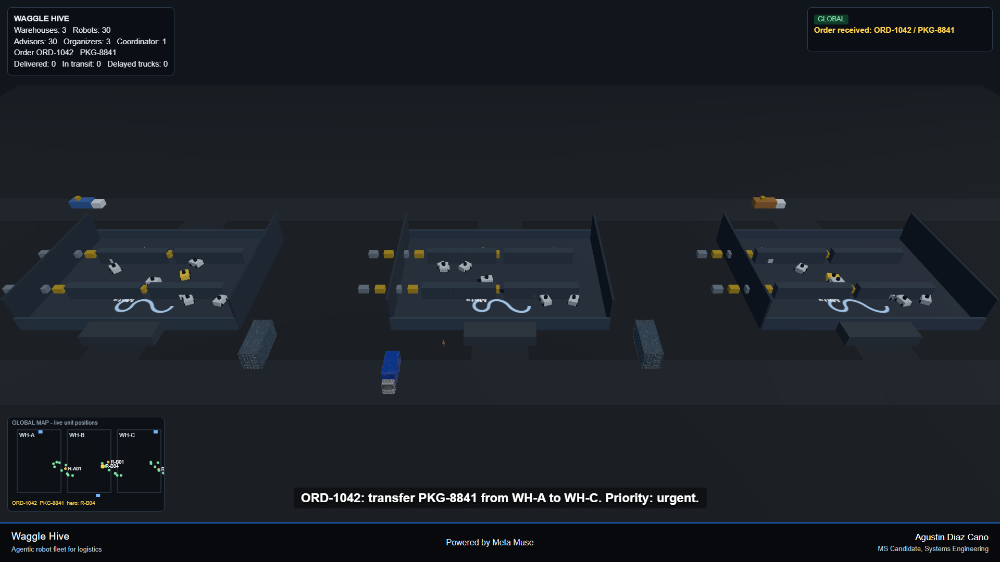
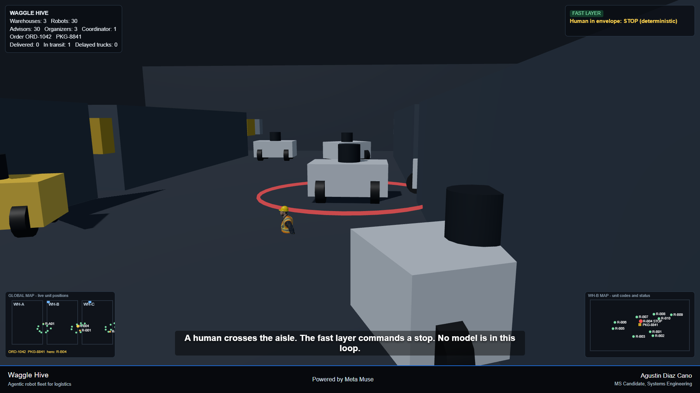
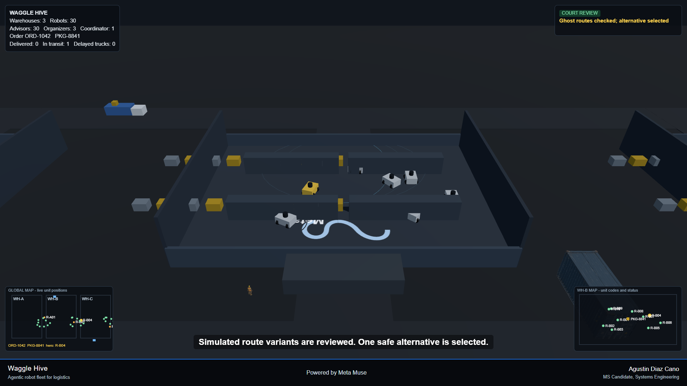

## Demo

Deterministic 180 s 3D demo (`demo/index.html`, fixed-time captures at 1920x1080). Mock presentation events only; measured results live in `results/`.

*Global network: WH-A, WH-B and WH-C, 30 robots, delivery trucks and shipping containers, with the live global map (bottom left).*

*WH-B interior: carrier R-B04 stopped by the deterministic fast layer (red safety ring) while a worker crosses the aisle; WH-B unit map bottom right.*

*Route review: WH-B robots with simulated ghost route variants checked before one safe alternative is selected; shipping container and truck GLB models at the edges.*
